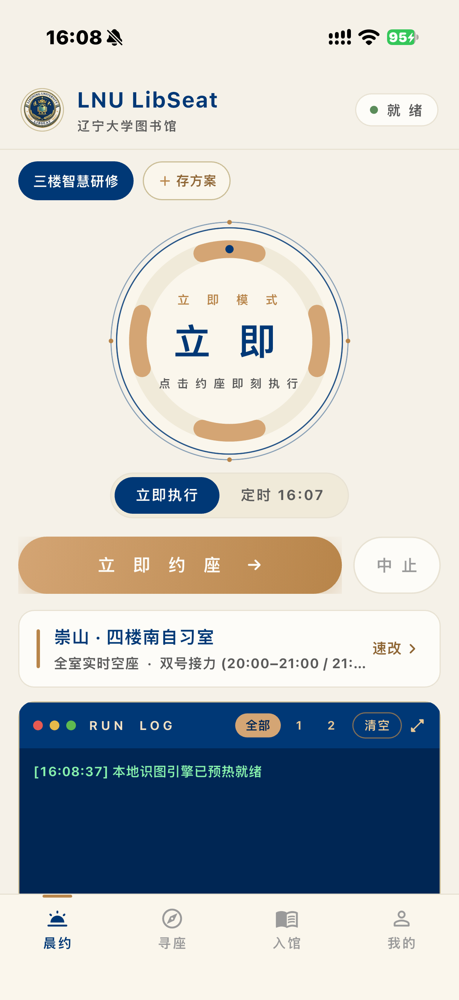
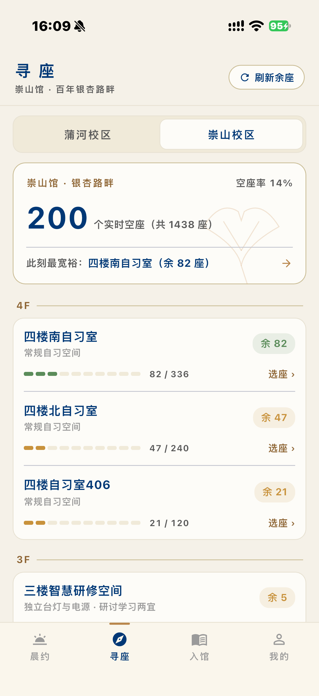
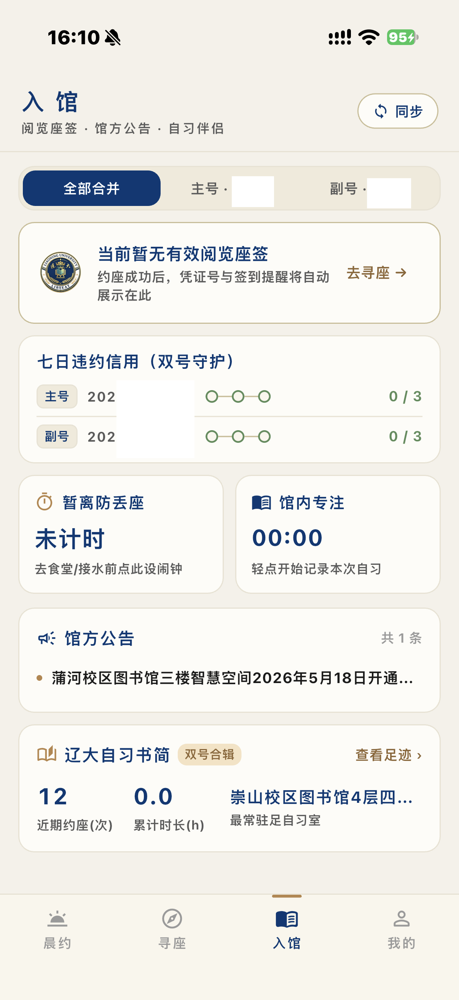

<div align="center">

<table border="0" cellpadding="0" cellspacing="0">
<tr>
<!-- Logo -->
<td width="250" align="center" valign="middle">

</td>
<!-- 标题 + 标语 + 徽章 -->
<td colspan="3" valign="middle" padding-left="10">

<h1 align="left">LNU-LibSeat</h1>

<h3 align="left">🎯 辽宁大学图书馆 · 全平台智能抢座神器（主推 Android & Windows · 同步支持 iOS & macOS）</h3>

<p align="left"><strong>纯 HTTP API 毫秒级直连 · 彻底告别浏览器 · 端侧原版无损 ONNX 识图 · 手机独立版 & 桌面端四端覆盖</strong></p>

<p align="left">
<a href="docs/ANDROID_INSTALL_GUIDE.md"></a>
<a href="#-windows-电脑端主力推荐--解压双击即用"></a>
<a href="docs/IOS_INSTALL_GUIDE.md"></a>
<a href="#-苹果生态专区iphone--mac"></a>
<a href="https://onnxruntime.ai/"></a>
<a href="https://github.com/XUNRANA/LNU-LibSeat-Automation/actions/workflows/ci.yml"></a>
<a href="https://github.com/XUNRANA/LNU-LibSeat-Automation/releases/latest"></a>
<a href="#-免责声明"></a>
<a href="https://github.com/XUNRANA/LNU-LibSeat-Automation"></a>
</p>

</td>
</tr>
<!-- 核心数据行 -->
<tr>
<td align="center" width="250" height="155"><h1>⚡</h1><b>0.55s</b> 纯 API 核心下单<br>彻底移除浏览器与驱动</td>
<td align="center" width="250" height="155"><h1>🤖</h1><b>Android 0 元直装</b><br>脱离电脑 · 5 重隔夜保活</td>
<td align="center" width="250" height="155"><h1>🪟</h1><b>Windows 双击即用</b><br>内置防休眠 · 瘦身 400MB+</td>
<td align="center" width="250" height="155"><h1>🧠</h1><b>5 个无损 ONNX 离线</b><br>全平台同源同精度 · 0 元成本</td>
</tr>
</table>

</div>

---

> [!IMPORTANT]
> ✨ **LNU-LibSeat v6.0.0 全平台纯 HTTP API 引擎已上线！**
> - 🏆 **首选主推 · Android 手机独立版**：`0 元直接安装、永久生效`，100% 脱离电脑、全馆 21 室实时余座雷达、5 重 06:30 隔夜防杀与 Android 14 锁屏全屏解冻、系统级签到防违约提醒。👉 **[Android 直装与保活教程](docs/ANDROID_INSTALL_GUIDE.md)** · **[手机版功能全览](mobile/README.md)**
> - 🏆 **首选主推 · Windows 电脑桌面版**：彻底移除 Selenium / 浏览器 / OpenCV 依赖，解压双击即用、内置防休眠、实测核心下单 **0.55 秒**。👉 **[全平台快速上手](docs/QUICKSTART.md)** · **[v5 → v6 升级指南](docs/MIGRATION_V5_TO_V6.md)**
> - 🍎 **苹果生态 · iPhone (iOS) & Mac (macOS)**：同步提供 iOS 免越狱 0 元自签 `.ipa`（内置锁屏静音保活 + 银杏夜守）与 macOS 原生 `.app`。👉 **[iOS 零元安装教程](docs/IOS_INSTALL_GUIDE.md)** · **[v6.0.0 发布说明](docs/RELEASE_NOTES_V6.md)**

---

> [!WARNING]
> 🛡️ **请务必准时到馆刷卡签到！** 辽大图书馆规定 7 天内累计 **3 次违约 = 黑名单 7 天**（期间无法预约）。手机版会在预约成功后自动注册系统级签到防违约提醒。

---

## 📦 一眼选版本 & 立即下载

全部安装包均托管于 **[GitHub Releases 最新版本](https://github.com/XUNRANA/LNU-LibSeat-Automation/releases/latest)**（零服务器、零打码费、离线内置全部 ONNX 识别模型）：

| 推荐档位 | 平台 | Releases 安装包文件名 | 体积 | 核心特点与上手方式 | 教程入口 |
| :--- | :--- | :--- | :---: | :--- | :--- |
| **🏆 主力推荐** | **🤖 Android 手机** | `LNU-LibSeat-Android-arm64.apk` | `165.9 MB` | **0 元直装、永久免续签**；脱离电脑、21 室余座雷达、5 重隔夜保活 + Android 14 锁屏解冻、系统签到提醒 | [Android 直装与保活教程](docs/ANDROID_INSTALL_GUIDE.md) |
| **🏆 主力推荐** | **🪟 Windows 电脑** | `LNU-LibSeat-v6.0.0-Windows-x86_64.zip` | `204.6 MB` | **解压双击 `LNU-LibSeat.exe` 即用**；零浏览器/零 Python、内置防休眠挂机、支持邮件 + Webhook 推送 | [全平台快速上手](docs/QUICKSTART.md) |
| 🍎 苹果生态 | **📱 iPhone / iPad** | `LNU-LibSeat-iOS-arm64-unsigned.ipa` | `146.7 MB` | **0 元免越狱自签**（Sideloadly / 爱思 / SideStore / 巨魔）；内置锁屏静音保活 + 银杏夜守，与安卓 UI 1:1 通用 | [iOS 零元安装教程](docs/IOS_INSTALL_GUIDE.md) |
| 🍎 苹果生态 | **💻 macOS 电脑** | `LNU-LibSeat-v6.0.0-macOS-arm64.zip` | `193.6 MB` | **Apple Silicon 原生 `.app`**；首次右键 `.command` 解除未签名限制，`caffeinate` 自动防休眠，双账号原生并行 | [下方 macOS 指引](#-mac-用户macos-apple-silicon) |

> [!TIP]
> **怎么选最省心？**
> - 有 **Android 手机** → 直接装 **Android 版**：不用开电脑、随时查全馆空座捡漏、不用 7 天续签，配完一次性保活白名单即可锁屏过夜！
> - 习惯 **电脑挂机** 或期末追求极致稳妥 → 用 **Windows 版**：零驱动折腾、内置防休眠，可配任务计划程序自动唤醒。
> - 只用 **iPhone / Mac** → 同样享有 100% 完整功能，按下方苹果生态专区指引几分钟即可搞定。

---

## 🎯 这是什么

一套面向辽宁大学**崇山 / 蒲河双校区 21 间自习室**的**全平台纯 HTTP API 自动约座与自习伴侣工具**，覆盖 **Android / Windows / iOS / macOS** 四端：

动态校准图书馆服务端时钟 → 极速加密登录 → 180ms 拉取全房实时空座 → 本地无损 ONNX 模型解点选验证码（实测 ~62ms）→ 一步提交 `freeBook`（核心下单 **0.55 秒**）→ 邮件 / Webhook 秒推 + 手机系统级签到防违约提醒。**全程本地运行，无需 Python、无需浏览器驱动、无需任何付费打码 API。**

### 适合谁用？

<table width="1000">
<tr>
<td align="center" width="333">
<h2>🎓 普通自习同学</h2>
睡前在安卓手机或 Windows 设好 06:30<br>
不用定早起闹钟，稳稳锁住心仪座位
</td>
<td align="center" width="333">
<h2>📚 考研党 / 期末全天党</h2>
主副双账号无缝接力 09:00-21:00<br>
不重叠时段自动同抢一座、全天免换座
</td>
<td align="center" width="333">
<h2>🧭 错峰 / 随时捡漏党</h2>
手机端 21 室实时空座雷达 + 单室网格直订<br>
桌面端首选留空即扫实时空座，0.55 秒锁定
</td>
</tr>
</table>

---

## 🤖 Android 手机独立版（主力推荐 · 0 元直装脱离电脑）

100% 脱离电脑、零服务器成本，端侧离线内置与电脑端同源的 **5 个原版无损 ONNX 模型**（总计 `159.52 MB`），Android 采用纯 CPU `BitmapFactory` 解码逐像素对齐 Python Pillow，**识别精度与桌面端一致**。

> 下方实机截图展示「晨约 · 寻座 · 入馆」核心频道（**Android 与 iOS 共用同一套 Flutter 界面，UI 与功能 1:1 通用**；完整 6 张实机图见 [mobile/README.md](mobile/README.md)）：

<div align="center">
<table>
<tr>
<td align="center" width="33%">
<br>
<b>晨约 · 抢座总控台</b><br>
<sub>立即 / 06:30 定时 · 快捷方案 · RUN LOG 终端</sub>
</td>
<td align="center" width="33%">
<br>
<b>寻座 · 双校区 21 室雷达</b><br>
<sub>实时空座率 · 单室网格直订 · 宝藏座笔记</sub>
</td>
<td align="center" width="33%">
<br>
<b>入馆 · 座签与违约守护</b><br>
<sub>双号违约监控 · 暂离防丢座 · 系统签到提醒</sub>
</td>
</tr>
</table>
</div>

### 30 秒上手 Android 版

1. **下载直装**：去 [Releases](https://github.com/XUNRANA/LNU-LibSeat-Automation/releases/latest) 下载 **`LNU-LibSeat-Android-arm64.apk`** 直接点击安装（未上架商业商店，遇「未知来源 / 未备案」点继续安装即可；后续升级直接覆盖不丢配置）。
2. **填卡选座**：切到 **「我的 ▸ 校园卡账号」** 填学号密码（初始密码通常 `000000`），回 **「晨约」** 点 `速改 >` 选校区、自习室与时段（首选座位可留空）。
3. **一次性保活设置（关键）**：进入 **「我的 ▸ 晨约守夜与后台保活」** 点亮 4 项体检开关（电池优化白名单、精确闹钟、系统通知、Android 14+ 锁屏全屏唤醒），再对照品牌开启「允许后台高耗电 + 自启动 + 多任务加锁」。
4. **锁屏过夜准点开抢**：App 内置 **5 重隔夜防杀**（`AlarmClock` 主唤醒 + `prepAt` 预热轻推双闹钟 + Android 14 锁屏全屏强解冻 + 动态 26h `WakeLock` + `WifiLock` + 被杀/重启自动续抢），同时提供 **「银杏夜守」OLED 纯黑床头模式** 作期末物理级双保险。

👉 **分品牌（vivo / 小米 / 华为 / OPPO）防锁屏冻结步骤与 2 分钟自测法**：**[🤖 Android 直装与隔夜保活教程](docs/ANDROID_INSTALL_GUIDE.md)** ｜ **[📱 手机独立版完整功能说明](mobile/README.md)**

---

## 🪟 Windows 电脑端（主力推荐 · 解压双击即用）

如果你更习惯电脑挂机或作为 06:30 终极保险，Windows 桌面版基于 **PySide6-Essentials + 纯 HTTP API** 构建，**零浏览器、零 Python、零 OpenCV**，打包体积较 v5 直减 **400MB+**（`613 MB → 204.6 MB`）。

### 三步开始（30 秒上手）

<table width="1000">
<tr>
<td align="center" width="333">
<h3>① 下载 ZIP</h3>
<p>前往 <a href="https://github.com/XUNRANA/LNU-LibSeat-Automation/releases/latest">GitHub Releases</a><br>下载 <code>LNU-LibSeat-v6.0.0-Windows-x86_64.zip</code><br>（204.6 MB，含全部离线模型）</p>
</td>
<td align="center" width="333">
<h3>② 解压 → 双击</h3>

<p>解压到任意纯英文或中文目录<br>直接双击 <code>LNU-LibSeat.exe</code></p>
</td>
<td align="center" width="333">
<h3>③ 填表 → 开抢</h3>

<p>选校区/自习室，填学号密码、时段与邮箱/手机推送<br>点「🚀 开始抢座」（首选座位可留空）</p>
</td>
</tr>
</table>

> [!NOTE]
> - **完全免环境**：不需要装 Python、不需要装 Edge/Chrome 或任何 WebDriver 驱动，只要 Windows 10/11 能访问 `libseat.lnu.edu.cn` 即可。
> - **整晚防休眠**：启动任务后自动调用 `SetThreadExecutionState` + 30 秒心跳防休眠（闲置 60 秒微抖动绕过笔记本 Modern Standby），结束自动还原。
> - **完整桌面上手与任务计划无人值守教程**：详见 **[📘 全平台快速上手指南](docs/QUICKSTART.md)** · **[⚙️ config.py 配置详解](docs/CONFIGURATION.md)**。

---

## 🍎 苹果生态专区（iPhone & Mac）

同样完整提供 **0 元离线方案**，底层纯 API 协议与 5 个无损 ONNX 模型与主力端 100% 一致：

### 📱 iPhone / iPad 用户（iOS 15.0+ · 0 元免越狱）
- **安装包**：去 [Releases](https://github.com/XUNRANA/LNU-LibSeat-Automation/releases/latest) 下载 **`LNU-LibSeat-iOS-arm64-unsigned.ipa`**（`146.7 MB`）。
- **安装方式**：支持 **Sideloadly / 爱思助手 / SideStore（无线续签）/ Xcode / TrollStore（巨魔永久）**，用免费 Apple ID（建议小号）0 元签名安装，7 天覆盖续签不丢数据。首次打开需开启「开发者模式」并信任证书。
- **06:30 过夜保活**：内置 **`UIBackgroundModes: audio` 全零静音锁屏保活**（不打断听歌、抢完自动释放）+ 纯 CPU `ImageIO` 解码（锁屏零 GPU 依赖），同时提供 **「银杏夜守」OLED 纯黑床头模式**。
- 👉 详细分步教程与避坑 FAQ：**[🍎 iPhone / iOS 零元安装与过夜教程](docs/IOS_INSTALL_GUIDE.md)**

### 💻 Mac 用户（macOS Apple Silicon）
- **安装包**：去 [Releases](https://github.com/XUNRANA/LNU-LibSeat-Automation/releases/latest) 下载 **`LNU-LibSeat-v6.0.0-macOS-arm64.zip`**（`193.6 MB`，较 v5 瘦身 438MB+）。
- **运行步骤**：解压后，首次**右键**点击 `首次运行请先双击我.command` →「打开」→ 再点「打开」以解除未付费签名拦截（若提示无法打开，前往 **系统设置 ▸ 隐私与安全性 ▸ 仍要打开**）；之后直接双击 `LNU-LibSeat.app`。
- **v6 改进**：彻底告别 Chrome / Safari 远程自动化限制，**双账号原生并行**，运行期间自动拉起系统 `caffeinate -dimsu` 阻止休眠；`config.py` 与 `logs/` 与 `.app` 同级。

---

## ⚖️ 手动 vs v5 浏览器 vs v6 纯 API 全平台

<table width="1000">
<tr><th align="left" width="190">核心维度</th><th align="left" width="210">😩 手动操作</th><th align="left" width="260">🐢 v5（Selenium 浏览器）</th><th align="left" width="340">⚡ v6（纯 API 全平台）</th></tr>
<tr><td><b>覆盖终端</b></td><td>网页 / 微信手点</td><td>仅 Win / Mac 电脑</td><td>✅ <b>Android + Windows 主力，同步覆盖 iOS + macOS</b></td></tr>
<tr><td><b>浏览器与驱动</b></td><td>手动打开网页</td><td>依赖 Edge/Chrome/Safari + 驱动匹配</td><td>✅ <b>完全无需浏览器与 WebDriver</b></td></tr>
<tr><td><b>登录与准备耗时</b></td><td>手动输码 10s+</td><td>提前 30s 启动浏览器</td><td>⚡ <b>&lt; 1s</b>，提前 15s 预热 + 5s 保活</td></tr>
<tr><td><b>核心下单速度</b></td><td>前端强制 3.5s 延时</td><td>被迫等 1.5s 按钮 + 2s 假动画 + sleep(2)</td><td>🚀 <b>直击接口</b>，实测锁定到下单仅 <b>0.55s</b></td></tr>
<tr><td><b>空座查找策略</b></td><td>肉眼翻座位图</td><td>盲扫全房座号，每座试错 1–3s</td><td>🎯 <b>180ms 实时全房空座快照</b>，手机端自带 21 室雷达</td></tr>
<tr><td><b>时钟偏差校准</b></td><td>看表容易偏 1–2s</td><td>依赖本机时钟</td><td>🕒 <b>HTTP Date + RTT/2 自动校准</b> + 5s 瞬态宽限</td></tr>
<tr><td><b>首选座位与兜底</b></td><td>必须手挑</td><td>v5 要求至少填 1 个首选</td><td>✅ <b>可留空抢实时空座</b>；支持 <code>FALLBACK_ROOMS</code> 多房顺延</td></tr>
<tr><td><b>通知与防违约</b></td><td>手动刷新查看</td><td>仅邮件通知</td><td>📲 <b>邮件 + 手机 Webhook 秒推 + 手机系统级签到防违约提醒</b></td></tr>
<tr><td><b>桌面安装包体积</b></td><td>—</td><td>Win 613MB / Mac 632MB</td><td>🧊 <b>Win 204.6MB / Mac 193.6MB</b>（直减 400MB+）</td></tr>
</table>

---

## 💎 v6.0.0 核心引擎特色（四端共享底座）

<table width="1000">
<tr>
<td width="333" valign="top">
<h3>⚡ 纯 HTTP API 直连引擎</h3>
完整实现 <code>AES-128-CBC</code> 凭据加密、<code>HMAC-SHA256</code> 全局签名与 <code>baseUrl.js</code> 动态密钥引导，桌面 Python 与移动 Dart 契约 100% 对齐，实测下单 <b>0.55s</b>。
</td>
<td width="333" valign="top">
<h3>🕒 服务端时钟校准 + 5s 瞬态宽限</h3>
通过 HTTP <code>Date</code> 头与 <code>RTT/2</code> 估算本机与服务端时间偏移，配合 <code>06:30:00–06:30:05</code> 瞬态未放座短退避重探（最多 5 次 × 250ms），不抢跑不误停。
</td>
<td width="333" valign="top">
<h3>🎯 实时空座 & 多自习室兜底</h3>
动态解析 <code>room_id</code> 与全房 <code>seat_id</code> 实时状态，首选直击 + 实时空座筛选，主房满员时按 <code>FALLBACK_ROOMS</code> 用 <code>room/stats2</code> 快查自动跳过满员房。
</td>
</tr>
<tr>
<td width="333" valign="top">
<h3>🧠 自适应 YOLOv8 + Siamese</h3>
优先按接口 <code>wordCheckCount</code>（1 或 3）、次选目标图槽位笔迹、兜底时间窗三级路由 Click1 / Click3 ONNX 模型，1:1 原生像素坐标直传，单次推理仅 <b>~62ms</b>。
</td>
<td width="333" valign="top">
<h3>🛡️ 限流护栏 & 协议漂移熔断</h3>
内置 <code>120ms ± 40ms</code> 最小请求间隔、1.5s 空座刷新冷却、连续 5 次限流/429 熔断与单会话 160 次请求硬顶；遇黑名单或 <code>ProtocolDriftError</code> 立即停机保号。
</td>
<td width="333" valign="top">
<h3>🧵 双号无缝接力防撞座</h3>
<code>SeatClaimCoordinator</code> 自动错开重叠时段的并发账号兜底座；不重叠接力时段（如 <code>09:00-15:00</code> + <code>15:00-21:00</code>）放行双号同抢心仪座，全天免换座。
</td>
</tr>
<tr>
<td width="333" valign="top">
<h3>📲 邮件 + Webhook + 防违约提醒</h3>
成功战报附带<b>预约单号与小票凭证</b>，内置 126 邮箱免配置直发，自动适配 <b>Bark / PushPlus / Server酱 / 企微 / 飞书 / 钉钉</b>；手机端自动注册开始前 15m / 截止前 10m 签到闹钟。
</td>
<td width="333" valign="top">
<h3>📁 轻量脱敏会话追溯</h3>
单次会话输出 <code>session.log</code> + <code>抢座顺序.txt</code> + <b>脱敏 <code>http_trace.jsonl</code></b>（自动抹除密码/Token/Cookie）+ <b>验证码候选/点击叠加图</b>（&lt; 50KB），双端均支持排障导出。
</td>
<td width="333" valign="top">
<h3>🧪 双端 111 项离线质量门禁</h3>
<b>92 个 Python 离线单测</b> + <b>19 个 Flutter 跨语言单测</b>（含 Pillow 22-bit 定点重采样 SHA-256 逐字节零误差校验）+ <code>ruff check .</code> 0 告警。
</td>
</tr>
</table>

---

## 🧠 验证码引擎：全平台同源 YOLOv8 + Siamese

> 完整技术细节见 [CAPTCHA_YOLO4_SIAMESE.md](docs/CAPTCHA_YOLO4_SIAMESE.md) 与 [API_PROTOCOL_CONTRACT.md](docs/API_PROTOCOL_CONTRACT.md)。
>
> 注：源码中部分文件名保留的 `yolo4`（如 `core/captcha_yolo4_siamese.py`）为历史实验代号，实际检测骨干为 **YOLOv8**，孪生匹配骨干为 **MobileNetV4-Conv-Medium**（训练管线见 `train/`）。

```text
POST /cap/captcha/<token> → 获取 330×160 背景图 + 70×36 目标字图 + wordCheckCount (1 或 3)
        ↓
   CaptchaService（桌面 core/captcha_service.py ｜ 移动 mobile/lib/core/captcha/）
   └─ 三级自适应路由：wordCheckCount → 目标图槽位笔迹 → 06:30–06:35 时间窗兜底
        ↓
   YOLOv8 ONNX 检测层（640×640 letterbox）→ 恰好 4 个候选字框
        ↓
   Siamese ONNX 相似度层（MobileNetV4 112×112 BICUBIC）→ 1 点或 3 点原生像素坐标
        ↓
   GET /cap/checkCaptcha (Base64 JSON) → POST /rest/v2/freeBook (multipart/form-data)
```

- **登录 4 位图形码**：桌面打包版使用精简提取的 `ddddocr_lite/common_old.onnx`（13 MB，零 OpenCV）；手机端内置同款 `common_old.onnx` + `charset_old.json` 离线推理。
- **零误差跨端对齐**：手机端完整移植 Python Pillow 22-bit 定点 `BILINEAR / BICUBIC / LANCZOS` 重采样与 ITU-R 601-2 灰度公式，Android 走原生 CPU `BitmapFactory`、iOS 走原生 CPU `ImageIO`，熄屏后台无需 GPU 也能稳定解图。

---

## 🛟 高频 FAQ

<details>
<summary><b>Q1: 手机端（Android / iOS）和电脑端（Windows / macOS）哪个更推荐？</b></summary>

- **日常最省心 → Android 手机版**：0 元永久直装、不用开电脑、支持全馆 21 室实时余座雷达与系统级签到防违约提醒；配好一次本机后台白名单后即可锁屏过夜准点开抢。
- **期末/考研挂机最稳妥 → Windows 电脑版**：解压双击即用、内置防休眠、零系统省电冻结风险，可配任务计划程序自动唤醒。
- **两者配合体验最佳**：平时手机查余座/收签到提醒，重要日子手机「银杏夜守」插电或 Windows 挂机双保险。iPhone 与 Mac 用户同样完整支持，仅需按苹果生态教程完成一次性签名或解除限制。
</details>

<details>
<summary><b>Q2: Android 锁屏后如果倒计时暂停了怎么办？</b></summary>

国产 Android 12–16 系统（如 vivo OriginOS / 小米 HyperOS / 华为 HarmonyOS / OPPO ColorOS）默认会在锁屏十几秒后对未加白名单的应用触发墓碑冻结。请确保安装最新版 `LNU-LibSeat-Android-arm64.apk`，并在 App **「我的 ▸ 晨约守夜与后台保活」** 点亮 4 项开关 + 对照品牌开启「允许后台高耗电 / 自启动 / 后台弹出界面 / 多任务加锁」，最后用「当前时间 + 2 分钟」锁屏自测验证。详见 [Android 保活教程](docs/ANDROID_INSTALL_GUIDE.md)。
</details>

<details>
<summary><b>Q3: Windows / macOS 需要装 Python 或 Chrome / Edge 吗？</b></summary>

✅ **什么都不用装**。v6 已彻底移除 Selenium 与浏览器依赖：下载 [Releases](https://github.com/XUNRANA/LNU-LibSeat-Automation/releases/latest) 对应 zip，Windows 解压双击 `LNU-LibSeat.exe`，macOS 首次右键 `首次运行请先双击我.command` 即可直接运行。
</details>

<details>
<summary><b>Q4: 我是 v5 老用户，原来的 config.py 还能直接用吗？</b></summary>

✅ **完全兼容**。把旧 `config.py` 复制到 v6 同级目录即可直接运行，废弃的 `BROWSER` / `DRIVER_PATH` / `WEBDRIVER_CACHE` 会被自动静默忽略。详情见 [v5 → v6 升级指南](docs/MIGRATION_V5_TO_V6.md)。
</details>

<details>
<summary><b>Q5: 抢座失败了怎么排查？</b></summary>

- **桌面端**：打开 `logs/sessions/<时间戳>_<学号>/`，内含 `session.log`、`抢座顺序.txt`、脱敏 `http_trace.jsonl`（密码/Token/Cookie 已自动抹除）与 `*_captcha_*.png` 候选/点击叠加图。
- **手机端**：进入 **「我的 ▸ 运行记录与识图回放」** 可直接回看每次验证码识别红绿点并一键导出脱敏诊断日志。
</details>

<details>
<summary><b>Q6: 怎么配手机端即时推送（Webhook）？</b></summary>

在桌面 GUI 账号卡「**手机推送**」框（或 `config.py` 的 `WEBHOOK_URL`，手机端亦可在「我的 ▸ 战报与推送」中配置）直接粘贴 URL 即可自动识别：
- **Bark（iOS）**：`https://api.day.app/<DeviceKey>/`
- **PushPlus（微信）**：`https://www.pushplus.plus/send?token=<Token>`
- **Server酱（微信）**：`https://sctapi.ftqq.com/<SendKey>.send`
- **企业微信 / 飞书 / 钉钉群机器人**：直接粘贴机器人 Webhook 地址
</details>

<details>
<summary><b>Q7: iPhone 免费自签 7 天到期后配置会丢吗？</b></summary>

**不会丢失。** 不要先卸载 App，直接用原工具（Sideloadly / 爱思助手 / SideStore）使用同一个 Apple ID 覆盖重签一次即可恢复，学号密码与方案全部保留。详见 [iOS 安装教程](docs/IOS_INSTALL_GUIDE.md)。
</details>

---

## 📖 文档导航

<table width="1000">
<tr>
<td align="center" width="250">
<h3>🤖</h3>
<a href="docs/ANDROID_INSTALL_GUIDE.md"><b>Android 直装与保活教程</b></a><br>
<sub>⭐ 主推 · 0 元永久装 & 国产 ROM 防冻结</sub>
</td>
<td align="center" width="250">
<h3>📘</h3>
<a href="docs/QUICKSTART.md"><b>全平台快速上手指南</b></a><br>
<sub>⭐ 主推 · Android & Windows 30 秒开抢</sub>
</td>
<td align="center" width="250">
<h3>📱</h3>
<a href="mobile/README.md"><b>手机独立版功能全览</b></a><br>
<sub>Android / iOS 同款界面 6 张实机截图</sub>
</td>
<td align="center" width="250">
<h3>🍎</h3>
<a href="docs/IOS_INSTALL_GUIDE.md"><b>iOS 零元安装教程</b></a><br>
<sub>Sideloadly / 爱思 / SideStore / 保活</sub>
</td>
</tr>
<tr>
<td align="center" width="250">
<h3>📦</h3>
<a href="docs/RELEASE_NOTES_V6.md"><b>v6.0.0 发布说明</b></a><br>
<sub>全平台纯 API 重构与实测亮点</sub>
</td>
<td align="center" width="250">
<h3>🚀</h3>
<a href="docs/MIGRATION_V5_TO_V6.md"><b>v5 → v6 升级指南</b></a><br>
<sub>桌面端老用户无缝迁移必读</sub>
</td>
<td align="center" width="250">
<h3>⚙️</h3>
<a href="docs/CONFIGURATION.md"><b>桌面端配置详解</b></a><br>
<sub>config.py 全字段与多房兜底</sub>
</td>
<td align="center" width="250">
<h3>🛠️</h3>
<a href="docs/MOBILE_GUIDE.md"><b>移动端架构与构建</b></a><br>
<sub>APK / IPA 本地打包与跨语言对齐</sub>
</td>
</tr>
<tr>
<td align="center" width="250">
<h3>🏗️</h3>
<a href="docs/ARCHITECTURE.md"><b>全仓架构文档</b></a><br>
<sub>桌面 Python + 移动 Flutter 双端架构</sub>
</td>
<td align="center" width="250">
<h3>🔌</h3>
<a href="docs/API_PROTOCOL_CONTRACT.md"><b>纯 API 协议契约</b></a><br>
<sub>脱敏端点、AES/HMAC 签名与字段</sub>
</td>
<td align="center" width="250">
<h3>🧠</h3>
<a href="docs/CAPTCHA_YOLO4_SIAMESE.md"><b>验证码识别引擎</b></a><br>
<sub>双端同源 YOLOv8 + Siamese 详解</sub>
</td>
<td align="center" width="250">
<h3>🗂️</h3>
<a href="docs/README.md"><b>全部文档索引</b></a><br>
<sub>含 GUI / 反馈 / 参数 / 历史档案</sub>
</td>
</tr>
</table>

---

## 🛠️ 开发者：从源码运行 / 四端本地打包

<details>
<summary><b>桌面端 Python 源码运行与测试</b></summary>

```powershell
git clone https://github.com/XUNRANA/LNU-LibSeat-Automation
cd LNU-LibSeat-Automation
python -m venv .venv
.\.venv\Scripts\activate
pip install -r requirements.txt
python gui_qt.py        # 桌面 GUI
# 或 python main.py     # 纯 CLI 无界面运行
```

跑全量离线单元测试与静态检查（零浏览器依赖）：

```powershell
pip install pytest ruff
pytest tests/ -q        # 92 项 Python 纯离线单测
ruff check .            # 0 告警阻塞门槛
cd mobile && flutter test  # 19 项 Flutter 跨语言契约与界面单测
```
</details>

<details>
<summary><b>一键构建四端安装包：Android (.apk) / Windows (.exe) / iOS (.ipa) / macOS (.app)</b></summary>

- **🤖 Android（主推）**：`python build_android.py` → 产出 `dist/辽宁大学图书馆座位预约.apk`（与 Releases 中 `LNU-LibSeat-Android-arm64.apk` 为同一 ARM64 离线包）
- **🪟 Windows（主推）**：`python build.py` → 产出 `dist/LNU-LibSeat-v6.0.0/` 与 `.zip`（隔离 venv，仅 `PySide6-Essentials` + `ddddocr_lite`，零 Selenium / OpenCV）
- **🍎 iOS（需在 Mac 上装 Xcode + Flutter + CocoaPods）**：`python3 build_ios.py` → 产出免签名 `dist/LNU-LibSeat-iOS-arm64-unsigned.ipa`
- **💻 macOS（需在 Mac 上运行）**：`python3 build_mac.py` → 产出 `dist/LNU-LibSeat-v6.0.0-macOS-<arch>.zip`
- 云端构建工作流 `.github/workflows/build-windows.yml` / `build-macos.yml` 仅保留手动触发（`workflow_dispatch`），移动端打包说明详见 [MOBILE_GUIDE.md](docs/MOBILE_GUIDE.md)。
</details>

<details>
<summary><b>项目结构</b></summary>

```text
LNU-LibSeat-Automation/
├── build_android.py / build_ios.py  # 📱 Android (.apk) & iOS 免签名 (.ipa) 一键构建
├── build.py / build_mac.py          # 📦 Windows & macOS 精简隔离 venv 打包脚本
├── mobile/                          # 📱 Flutter 跨平台手机独立版（Android & iOS）
│   ├── README.md                    #   手机独立版完整说明与 6 张实机截图
│   ├── lib/                         #   纯 API 引擎 / 端侧 5 ONNX 识图 / 四频道 UI / 保活
│   ├── android/                     #   Android 原生 5 重隔夜保活、签到闹钟与 BitmapFactory CPU 解码
│   └── ios/                         #   iOS 锁屏静音保活、纯 CPU ImageIO 解码与深链
├── scripts/                         # 🔧 移动端 5 ONNX 资源导出与跨语言测试向量生成
├── gui_qt.py & ui_qt/               # 🖥️ PySide6 桌面端入口与模块化界面
├── main.py                          # 🚀 桌面 CLI 薄入口（委托 logic.orchestrator）
├── config.example.py                # ⚙️ 桌面配置模板（支持 FALLBACK_ROOMS / WEBHOOK_URL）
├── requirements.txt                 # requests / pycryptodome / Pillow / ddddocr / numpy / onnxruntime / PySide6
├── info/                            # 📋 崇山 & 蒲河 21 间自习室离线座号索引
├── core/                            # 🛠️ 纯 API 协议与基础设施层（零 Selenium / 零 OpenCV）
│   ├── protocol.py                  #   端点常量 / baseUrl.js 动态解析 / 漂移与过期异常
│   ├── api_crypto.py                #   AES-128-CBC 登录加密 + HMAC-SHA256 签名头
│   ├── libseat_client.py            #   强类型 LibSeatClient Protocol + requests 连接池
│   ├── clock_sync.py                #   HTTP Date + RTT/2 服务端时钟校准
│   ├── rate_limiter.py              #   请求最小间隔 / Jitter / 空座冷却 / 429 熔断
│   ├── captcha_service.py           #   Click1 + Click3 三级自适应路由 + 线程锁 + 预热
│   ├── captcha.py                   #   登录 4 位图形码（优先 ddddocr_lite 纯 ONNX）
│   ├── captcha_yolo4_siamese.py     #   Click3 求解器
│   ├── captcha_click1_yolo4_siamese.py # Click1 求解器
│   ├── yolo_onnx.py                 #   YOLOv8 ONNX 推理封装
│   ├── checkpoints/                 #   4 个点击验证码运行时 ONNX 权重
│   ├── session_recorder.py          #   脱敏 http_trace.jsonl + 验证码叠加诊断图
│   ├── notifications.py             #   内置 SMTP 邮件 + 7 类手机 Webhook 推送
│   └── logger.py / paths.py / utils.py
├── logic/                           # 🧠 纯 API 业务编排层（零 GUI 依赖）
│   ├── orchestrator.py              #   多账号调度 / 维护期重连 / Token 自动重登
│   ├── booker.py                    #   ApiSeatBooker（首选直击 / 实时空座 / 多房兜底 / 宽限重试）
│   ├── seat_strategy.py             #   实时空座排序 / FALLBACK_ROOMS / 多账号防撞座协调器
│   └── result_classifier.py         #   纯函数结果分类（与 Dart 端 100% 语义对齐）
├── model/ & train/                  # 🏋️ 验证码模型定义与完整自训练管线
├── tests/                           # ✅ 92 项 Python 离线单测（移动端 19 项见 mobile/test/）
└── docs/                            # 📖 Android/iOS 安装教程 / 快速上手 / 架构 / 协议 / 归档
```
</details>

---

## ☕ 求赞助 — 支持持续开发

> [!NOTE]
> v5 告别了付费验证码 API，v6 彻底告别浏览器并带来 **Android / Windows / iOS / macOS 四端纯 API 独立离线时代**。
> 作者仍在持续维护协议适配、模型迭代与手机端保活优化——**随手扫码赞助**就是最大的鼓励 ❤️

<table align="center" border="0" cellspacing="0">
<tr>
<td width="300" align="center" valign="middle">
  <b>☕ 你的赞助将用于</b><br>
  <b>模型训练 · 协议适配 · 真机测试</b><br>
  <sub>让免费持续 ❤️</sub>
</td>
<td align="center"><br><b>微信支付</b></td>
</tr>
</table>

---

## 🏛️ 辽大图书馆官方预约规则

<table width="1000">
<tr><th align="left" width="250">规则</th><th align="left" width="750">说明</th></tr>
<tr><td><b>预约入口</b></td><td><code>libseat.lnu.edu.cn</code> / 微信公众号 / 馆内刷卡</td></tr>
<tr><td><b>登录凭据</b></td><td>校园卡号，初始密码 <code>000000</code></td></tr>
<tr><td><b>签到窗口</b></td><td>预约开始前 30 分钟 ～ 开始后 30 分钟内</td></tr>
<tr><td><b>每日上限</b></td><td>≤ 3 次预约，单次 ≤ 6 小时，每日 ≤ 3 次取消</td></tr>
<tr><td><b>放座时间</b></td><td><b>每日 06:30</b></td></tr>
<tr><td><b>违约处罚</b></td><td>🚫 7 天内累计 3 次违约 → <b>黑名单 7 天</b></td></tr>
</table>

---

## ⚖️ 免责声明

本项目仅供**技术交流与个人自习便利**，请严格遵守辽宁大学图书馆规定：
- 请准时到馆刷卡签到，珍惜公共学习资源，避免进入黑名单；
- 请勿修改或绕过内置限流保护对学校服务器发起高频请求；
- 请勿将抢到的座位转售或用于其他商业目的；
- **所有使用后果由使用者自行承担**。

## 🙏 致谢

- **[geTiger/get_LibSeat](https://github.com/geTiger/get_LibSeat)** — 辽宁大学图书馆抢座的最早开源实现，项目最初的流程与思路参考自此。
- **[MgArcher/Text_select_captcha](https://github.com/MgArcher/Text_select_captcha)** — 文字点选验证码识别开源方案，自研 **YOLOv8 + Siamese** 管线架构源自此项目。
- **[@MorinGale](https://github.com/MorinGale)** — 在 [Issue #4](https://github.com/XUNRANA/LNU-LibSeat-Automation/issues/4) 中率先提出并实测验证了纯 API 路线，直接促成了 v6.0.0 的诞生。

## 📄 License

[MIT](https://opensource.org/licenses/MIT) © XUNRANA

---

<div align="center">

**如果这个项目帮到了你，请给个 ⭐ Star 鼓励作者持续维护！**

[⭐ 给项目加星](https://github.com/XUNRANA/LNU-LibSeat-Automation) · [📦 前往 Releases 下载](https://github.com/XUNRANA/LNU-LibSeat-Automation/releases/latest) · [☕ 赞助一杯奶茶](#-求赞助--支持持续开发) · [🐛 反馈 Bug](https://github.com/XUNRANA/LNU-LibSeat-Automation/issues)

</div>
