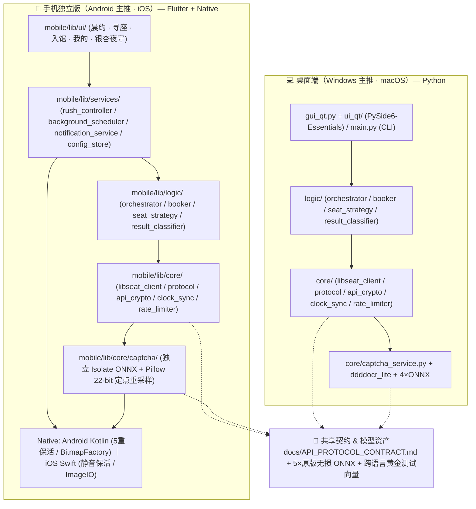
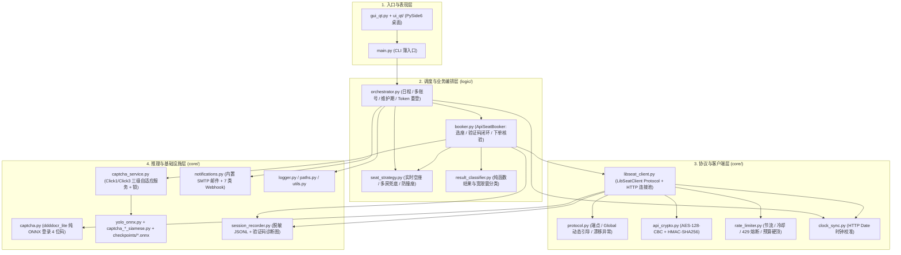
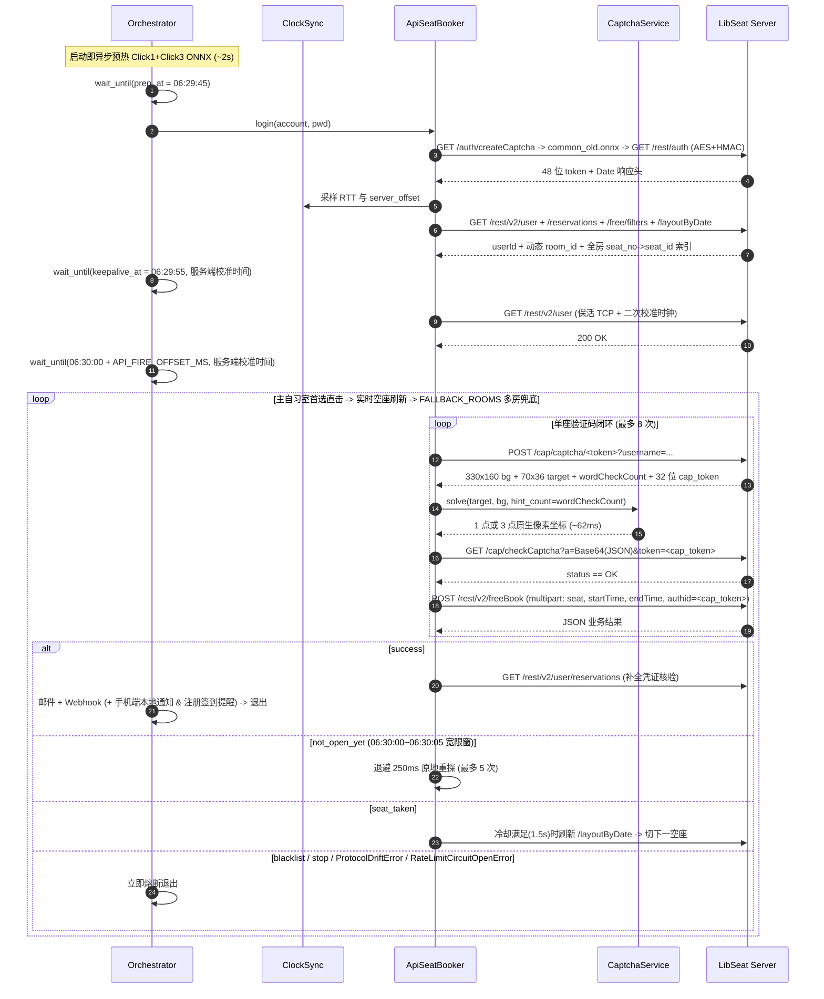

<div align="center">

# 🏗️ 全仓架构与开发文档

### LNU-LibSeat v6.0.0 — 桌面端（Python）+ 移动端（Flutter）双端同源纯 HTTP API 架构

[← 返回 README](../README.md) ·
[纯 API 协议契约](API_PROTOCOL_CONTRACT.md) ·
[移动端技术架构与构建](MOBILE_GUIDE.md) ·
[验证码识别引擎](CAPTCHA_YOLO4_SIAMESE.md) ·
[v6.0.0 发布说明](RELEASE_NOTES_V6.md)

</div>

---

## 📑 目录

- [v6.0.0 架构跃迁](#v600-架构跃迁)
- [全仓双端架构总览](#全仓双端架构总览)
- [桌面端四层架构（Python）](#桌面端四层架构python)
- [移动端同源架构（Flutter + 原生保活）](#移动端同源架构flutter--原生保活)
- [核心抢座时序（06:30 定时模式）](#核心抢座时序0630-定时模式)
- [各模块详解](#各模块详解)
- [关键设计决策](#关键设计决策)
- [四端构建与瘦身策略](#四端构建与瘦身策略)

---

## v6.0.0 架构跃迁

v6.0.0 **彻底移除 Selenium、WebDriver、OpenCV (`cv2`) 与浏览器录屏**，将桌面端与移动端统一到同一套 **纯 HTTP API + 本地无损 ONNX** 底座：

| 变革 | 影响范围 | 关键文件 |
| :--- | :--- | :--- |
| **纯 HTTP API 协议与加解密** | 桌面 + 移动 | `core/protocol.py`、`core/api_crypto.py`、`core/libseat_client.py`；移动端 `mobile/lib/core/` |
| **服务端时钟校准** | 桌面 + 移动 | `core/clock_sync.py` / `mobile/lib/core/clock_sync.dart`（HTTP `Date` + `RTT/2`） |
| **限流与防风控护栏** | 桌面 + 移动 | `core/rate_limiter.py` / `mobile/lib/core/rate_limiter.dart`（间隔 + Jitter + 冷却 + 429 熔断 + 预算硬顶） |
| **全天候自适应验证码服务** | 桌面 + 移动 | `core/captcha_service.py` / `mobile/lib/core/captcha/`（`wordCheckCount` → 槽位笔迹 → 时间窗三级路由） |
| **API 级脱敏追溯** | 桌面 + 移动 | `core/session_recorder.py` / `mobile/lib/core/session_recorder.dart`（脱敏 `http_trace.jsonl` + 轻量诊断图） |
| **实时空座 + 多房兜底 + 防撞座** | 桌面 + 移动 | `logic/seat_strategy.py`、`logic/booker.py`、`logic/orchestrator.py`；移动端 `mobile/lib/logic/` |
| **独立离线手机端（Android 主力 + iOS）** | 移动端 | `mobile/`、`scripts/prepare_mobile_assets.py`、`scripts/dump_test_vectors.py`、`build_android.py`、`build_ios.py` |
| **桌面端极致瘦身 400MB+** | 桌面构建 | `build.py` / `build_mac.py`（`PySide6-Essentials` + `ddddocr_lite` + 零 `cv2` + 仅打 `*.onnx`） |

---

## 全仓双端架构总览

桌面端（Windows 主力 / macOS）与移动端（Android 主力 / iOS）采用 **双语言同构设计**：核心协议、加解密、时序调度、结果分类与 5 个 ONNX 权重 100% 同源，由 `scripts/dump_test_vectors.py` 与 `mobile/test/` 跨语言黄金向量测试强制锁死一致性。



---

## 桌面端四层架构（Python）

桌面端依赖方向严格单向：**入口层 → 业务编排层 → 协议客户端层 → 推理与基础设施层**，`logic/` 与 `core/` 零 `PySide6` 依赖。



---

## 移动端同源架构（Flutter + 原生保活）

移动端核心模块与桌面端保持 1:1 映射，并针对手机端无电脑独立运行场景补齐 4 项原生能力（详见 [MOBILE_GUIDE.md](MOBILE_GUIDE.md)）：

- **端侧独立 Isolate 推理（`onnx_worker.dart`）**：5 个原版无损 ONNX 模型在独立 Isolate 推理，不阻塞 UI 渲染；结合原生纯 CPU 解码（Android `BitmapFactory` / iOS `ImageIO`）与 `pil_image_ops.dart` 22-bit 定点重采样，息屏后台无需 GPU。
- **Android 5 重隔夜防杀与 Android 14 解冻（`MainActivity.kt`）**：`RushForegroundService`（`FOREGROUND_SERVICE_TYPE_SPECIAL_USE`，`IMPORTANCE_DEFAULT` 静音通道）+ 动态 26h `WakeLock` + `WifiLock` + `AlarmClock` 主唤醒（`-20s`）/ `setExactAndAllowWhileIdle` 预热轻推双闹钟 + `MODE_BACKGROUND_ACTIVITY_START_ALLOWED` / `CATEGORY_ALARM` 全屏唤醒强解冻 + `RushBootReceiver` 重启恢复。
- **iOS 锁屏静音保活（`AppDelegate.swift`）**：`UIBackgroundModes: audio` 内存生成全零静音 WAV 循环播放（`.mixWithOthers` 不打断其他音频），抢完自动关闭释放。
- **系统级签到防违约提醒（`notification_service.dart`）**：预约成功或同步座签时，自动注册开始前 15 分钟温和提醒与开始后 20 分钟（距 30 分钟违约截止剩 10 分钟）紧急提醒（Android `CheckinReminderReceiver` / iOS `UNUserNotificationCenter` `.timeSensitive`）。

---

## 核心抢座时序（06:30 定时模式）

桌面端（`logic/orchestrator.py`）与移动端（`mobile/lib/logic/orchestrator.dart`）执行完全一致的三段式时序：



### 关键时间点常量（桌面 & 移动完全一致）

| 时刻 | 事件 | 常量（Python / Dart） |
| :--- | :--- | :--- |
| 启动瞬间 | 后台异步预热 Click1 + Click3 ONNX | `start_captcha_model_preload` / `OnnxWorker.warmup` |
| `06:29:25`（仅 Android） | 系统 `AlarmClock` 主闹钟穿透休眠并解冻 | `prepAt - 20s`（`ALARM_REQUEST_CODE = 630`） |
| `06:29:45` | 登录 + 动态解析自习室 + 拉全房座位索引（Android 同步发副闹钟轻推） | `PREP_LEAD_SECONDS = 15` / `prepLeadSeconds = 15` |
| `06:29:55` | 轻量保活 + 二次校准服务端时钟 | `KEEPALIVE_LEAD_SECONDS = 5` / `keepaliveLeadSeconds = 5` |
| `06:30:00.200` | 按服务端校准时间准点开抢 | `API_FIRE_OFFSET_MS = 200` / `defaultFireOffsetMs = 200` |
| `06:30:00–06:30:05` | 瞬态未放座短宽限重探窗口（250ms × 5 次） | `OPEN_GRACE_WINDOW_SECONDS = 5.0` |

---

## 各模块详解

### 桌面端协议与基础设施层（`core/`）

| 模块 | 职责 |
| :--- | :--- |
| `core/protocol.py` | 全量端点常量、`baseUrl.js` `Global` 动态解析、座位状态集合、`ProtocolDriftError` / `TokenExpiredError` |
| `core/api_crypto.py` | `AES-128-CBC + PKCS7` 登录凭据加密、`HMAC-SHA256` 全局签名头、`Base64(JSON)` 坐标编码 |
| `core/libseat_client.py` | `LibSeatClient` Protocol 与 `HttpLibSeatClient`（`requests.Session` 连接池 4×4、自动签名、喂 `ClockSync`、强 Schema 校验） |
| `core/clock_sync.py` | RFC 7231 HTTP `Date` 头 + `RTT/2` 偏移估算，择优低 RTT 样本并拒收 > 3600s 极端异常 |
| `core/rate_limiter.py` | 最小请求间隔（`120ms ± 40ms`）、空座刷新冷却（`1.5s`）、指数退避、连续 5 次限流/429 熔断、单会话 160 次请求硬顶 |
| `core/captcha_service.py` | 统一 Click1 / Click3 预热与线程锁，三级自适应路由 |
| `core/captcha.py` | 登录 4 位图形码（零 OpenCV，优先加载 `ddddocr_lite/common_old.onnx` + `charset_old.json`） |
| `core/yolo_onnx.py` / `captcha_*_siamese.py` | 纯 Pillow + numpy + ONNX Runtime 推理封装与 4 个 `core/checkpoints/*.onnx` 模型 |
| `core/session_recorder.py` | 递归脱敏 `http_trace.jsonl` + 拼合目标字/背景图/YOLO 绿圈/点击红点的轻量诊断图 |
| `core/notifications.py` | 内置 126 SMTP 邮件 + 7 类手机 Webhook 推送（自动脱敏日志 URL） |
| `core/logger.py` / `paths.py` / `utils.py` | 按 `[account]` 分流轮转日志（10MB × 5）、冻结路径解析、北京时间工具 |

### 桌面端业务逻辑层（`logic/`）

| 模块 | 职责 |
| :--- | :--- |
| `logic/orchestrator.py` | 多账号并发总控（错开 `2s`）、日程计算、`wait_until`、维护期重连（`120s`）、Token 过期重登 |
| `logic/booker.py` | `ApiSeatBooker`：已有预约预检、首选直击、实时空座刷新、`FALLBACK_ROOMS` 多房切换、单座 8 次验证码闭环与 5s 宽限 |
| `logic/seat_strategy.py` | 座号归一化、`build_room_plan`、`plan_seat_candidates`、线程安全多账号防撞座 `SeatClaimCoordinator` |
| `logic/result_classifier.py` | 纯函数业务反馈分类（`classify_api_booking_result` + 向后兼容 `classify_booking_result`） |

### 桌面端表现层（`main.py` + `gui_qt.py` + `ui_qt/`）
- `main.py`：薄 CLI 入口，导出调度函数并委托 `logic.orchestrator.run_all_accounts()`。
- `ui_qt/`：PySide6-Essentials 模块化界面（详见 [GUI_QT_ARCHITECTURE.md](GUI_QT_ARCHITECTURE.md)）。

---

## 关键设计决策

| 决策 | 状态 | 理由 |
| :--- | :---: | :--- |
| **彻底移除 Selenium 与 OpenCV** | ✅ v6 | 消除浏览器 15–35s 冷启动、1.5GB 内存、驱动错配、前端 3.5s 假延时以及 OpenCV 重型二进制膨胀 |
| **双语言同构 + 黄金测试向量锁死** | ✅ v6 | 桌面 Python 与移动 Flutter 共享协议契约与 5 个原版无损 ONNX 模型，111 项单测杜绝行为漂移 |
| **协议单一来源 + `ProtocolDriftError` 熔断** | ✅ v6 | 端点/密钥集中于 `protocol.py` / `protocol.dart` 并动态引导 `baseUrl.js`，服务端改版即刻停机保号 |
| **精简 `ddddocr_lite` + 原生 CPU 解码** | ✅ v6 | 桌面端剥离冗余模型与 OpenCV；移动端用 `BitmapFactory`/`ImageIO` + Pillow 22-bit 定点重采样实现息屏零误差推理 |
| **HTTP `Date` 时钟校准 + 5s 瞬态宽限** | ✅ v6 | 精准吸收本机与服务端时钟误差，彻底取代盲目 `time.sleep(2)` |
| **强制内置限流与请求预算硬顶** | ✅ v6 | 防止纯 API 高速轮询触发校园网出口限流或校方升级风控 |
| **多账号防撞座仅拦截重叠时段** | ✅ v6 | 允许双账号接力（如 `09:00-15:00` + `15:00-21:00`）同抢一座免换座，重叠时段自动错开 |
| **轻量脱敏追溯取代 MP4 录屏** | ✅ v6 | 脱敏 `http_trace.jsonl` + `< 50KB` 验证码叠加图比视频更清晰、更安全且体积极小 |

---

## 四端构建与瘦身策略

```bash
# 🤖 Android（主推 · Windows / macOS 均可构建）
python build_android.py     # → dist/辽宁大学图书馆座位预约.apk (165.9 MB)

# 🪟 Windows（主推 · 需在 Windows 上运行）
python build.py             # → dist/LNU-LibSeat-v6.0.0-Windows-x86_64.zip (204.6 MB)

# 🍎 iOS（需在 macOS + Xcode + CocoaPods 上运行）
python3 build_ios.py        # → dist/LNU-LibSeat-iOS-arm64-unsigned.ipa (146.7 MB)

# 💻 macOS（需在 Apple Silicon Mac 上运行）
python3 build_mac.py        # → dist/LNU-LibSeat-v6.0.0-macOS-arm64.zip (193.6 MB)
```

桌面端 `build.py` / `build_mac.py` 核心瘦身措施（Windows `613 MB → 204.6 MB`，macOS `632 MB → 193.6 MB`）：
1. 仅安装 `PySide6-Essentials`（剔除 `QtWebEngine / QtPdf / QtQuick / Qt3D` 等 500MB+ 冗余模块）；
2. 零 OpenCV (`cv2`)、零 `selenium` / `webdriver-manager` / `mss`；
3. 从 `ddddocr` 仅提取 `common_old.onnx (13 MB) + charset_old.json` 到 `ddddocr_lite/`（剔除未用的 52MB `common.onnx` 与 19MB `common_det.onnx`）；
4. 仅拷贝 `core/checkpoints/*.onnx`（过滤排除本地 `.pt / .pth` 训练权重）；
5. CI 工作流 [`.github/workflows/ci.yml`](../.github/workflows/ci.yml) 在每次 push / PR 自动执行 `pytest` + `ruff check .` + `mypy .`；`build-windows.yml` / `build-macos.yml` 仅保留手动 `workflow_dispatch`。
