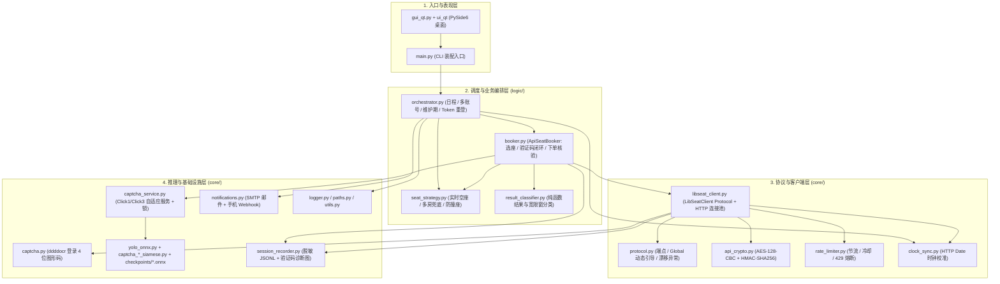
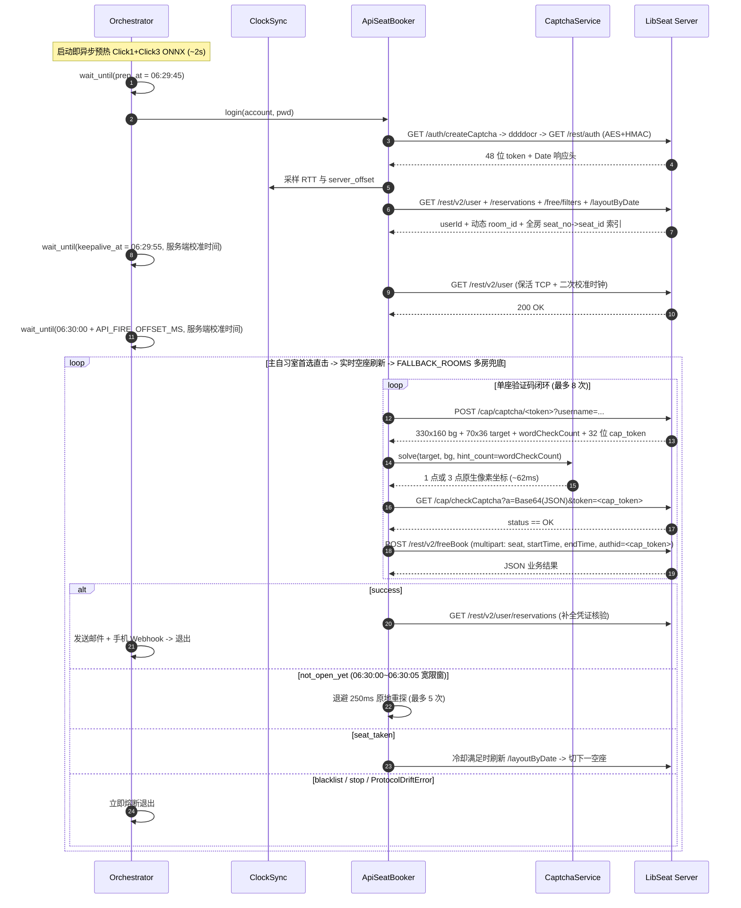

<div align="center">

# 🏗️ 架构与开发文档

### LNU-LibSeat v6.0.0 纯 API 引擎内部实现详解

[← 返回 README](../README.md) ·
[纯 API 协议契约](API_PROTOCOL_CONTRACT.md) ·
[配置详解](CONFIGURATION.md) ·
[v6.0.0 发布说明](RELEASE_NOTES_V6.md) ·
[v5 → v6 升级指南](MIGRATION_V5_TO_V6.md)

</div>

---

## 📑 目录

- [v6.0.0 架构跃迁](#v600-架构跃迁)
- [整体四层架构](#整体四层架构)
- [核心抢座时序（06:30 定时模式）](#核心抢座时序0630-定时模式)
- [各模块详解](#各模块详解)
- [关键设计决策](#关键设计决策)
- [PyInstaller 打包与瘦身](#pyinstaller-打包与瘦身)

---

## v6.0.0 架构跃迁

v6.0.0 **彻底移除 Selenium、WebDriver 与浏览器录屏**，重构为单一纯 HTTP API 引擎，实现以下核心解耦：

| 变革 | 影响层 | 关键文件 |
|---|---|---|
| **纯 HTTP API 客户端 + 协议隔离** | 协议与基础设施层 | `core/protocol.py`、`core/api_crypto.py`、`core/libseat_client.py` |
| **服务端时钟校准** | 基础设施层 | `core/clock_sync.py`（HTTP `Date` + `RTT/2`） |
| **限流与防风控护栏** | 基础设施层 | `core/rate_limiter.py`（最小间隔 + Jitter + 冷却 + 429 熔断） |
| **验证码统一自适应服务** | 基础设施层 | `core/captcha_service.py`（按 `wordCheckCount` + 槽位笔迹自动路由 Click1/Click3） |
| **API 级脱敏追溯** | 基础设施层 | `core/session_recorder.py`（`http_trace.jsonl` + 轻量验证码叠加诊断图） |
| **实时空座 + 多房兜底 + 防撞座** | 业务逻辑层 | `logic/seat_strategy.py`、`logic/booker.py`、`logic/orchestrator.py` |
| **手机端 Webhook 即时推送** | 基础设施层 | `core/notifications.py`（Bark / PushPlus / Server酱 / 企微 / 飞书 / 钉钉） |
| **彻底清除浏览器链** | 全仓 | 删除 `core/driver.py`、`core/screen_recorder.py`、`core/captcha_api.py`、`logic/navigator.py`、`logic/auth.py` |

---

## 整体四层架构

依赖方向严格单向：**入口层 → 业务编排层 → 协议客户端层 → 推理与基础设施层**，`logic/` 与 `core/` 零 `PySide6` 依赖，可直接对接 CLI、桌面 GUI 及后续 v6.1 手机端 Web/PWA。



---

## 核心抢座时序（06:30 定时模式）



### 关键时间点

| 时刻 | 事件 | 参数常量 |
|---|---|---|
| 启动瞬间 | 后台异步预热 Click1 + Click3 ONNX | `start_captcha_model_preload` |
| `06:29:45` | 登录 + 动态解析自习室 + 拉全房座位索引 | `PREP_LEAD_SECONDS = 15` |
| `06:29:55` | 轻量保活 + 二次校准服务端时钟 | `KEEPALIVE_LEAD_SECONDS = 5` |
| `06:30:00.200` | 按服务端校准时间准点开抢 | `API_FIRE_OFFSET_MS = 200` |
| `06:30:00–06:30:05` | 瞬态未放座短宽限重探窗口 | `OPEN_GRACE_WINDOW_SECONDS = 5.0` |

---

## 各模块详解

### 协议与基础设施层（`core/`）

| 模块 | 职责 |
|---|---|
| `core/protocol.py` | 端点常量、`baseUrl.js` `Global` 动态解析、座位状态枚举、`ProtocolDriftError` / `TokenExpiredError` |
| `core/api_crypto.py` | `AES-128-CBC + PKCS7` 登录凭据加密、`HMAC-SHA256` 请求签名头、`Base64(JSON)` 坐标编码（兼容 `pycryptodome` 与 `cryptography`） |
| `core/libseat_client.py` | `LibSeatClient` Protocol 与 `HttpLibSeatClient`（连接池复用、自动签名、自动喂 `ClockSync`、强 Schema 校验） |
| `core/clock_sync.py` | RFC 7231 HTTP `Date` 头 + `RTT/2` 补偿偏移估算，自动拒收极端异常时间 |
| `core/rate_limiter.py` | 单账号最小请求间隔（120ms ± 40ms）、空座快照冷却（1.5s）、指数退避、连续 429 熔断与单会话请求上限 |
| `core/captcha_service.py` | 统一 Click1 / Click3 预热与线程锁，按 `wordCheckCount` → 槽位笔迹 → 时间窗口三级自适应路由 |
| `core/captcha.py` | `ddddocr` 识别登录页 4 位图形验证码 |
| `core/yolo_onnx.py` / `captcha_*_siamese.py` | 纯字节流 ONNX 推理引擎与 4 个 `core/checkpoints/*.onnx` 模型 |
| `core/session_recorder.py` | 递归脱敏 `http_trace.jsonl` + 拼合 `target` / `bg` / YOLO 绿圈 / 点击红点的轻量 PNG 诊断图 |
| `core/notifications.py` | SMTP 邮件 + 手机端 Webhook 推送（自动识别 Bark / PushPlus / Server酱 / 企微 / 飞书 / 钉钉 / 通用 JSON） |
| `core/logger.py` / `paths.py` / `utils.py` | 按 `[account]` 分流日志、跨平台冻结路径解析、北京时间工具 |

### 业务逻辑层（`logic/`）

| 模块 | 职责 |
|---|---|
| `logic/orchestrator.py` | 多账号并发总控、日程计算、`wait_until`（支持服务端校准时钟）、维护期延迟/重连、Token 过期自动重登 |
| `logic/booker.py` | `ApiSeatBooker`：已有预约预检、首选直击、实时空座刷新、`FALLBACK_ROOMS` 多房切换、验证码闭环与瞬态宽限 |
| `logic/seat_strategy.py` | 座号归一化、`build_room_plan`、`plan_seat_candidates`、线程安全多账号防撞座 `SeatClaimCoordinator` |
| `logic/result_classifier.py` | 纯函数业务反馈分类（兼容 `classify_booking_result`，新增结构化 `classify_api_booking_result`） |

### 表现层（`main.py` + `gui_qt.py` + `ui_qt/`）

- `main.py`（39 行）：薄 CLI 入口，导出调度函数并调用 `logic.orchestrator.run_all_accounts()`。
- `ui_qt/`：PySide6 桌面界面；v6 移除了「浏览器」下拉框，新增「手机推送 Webhook」配置项，老 v5 `config.py` 自动静默兼容。

---

## 关键设计决策

| 决策 | 状态 | 理由 |
|---|---|---|
| **彻底移除 Selenium，单一纯 API 引擎** | ✅ v6 | 消除浏览器启动 15–35s、1.5GB 内存、驱动版本错配与前端 3.5s 假延时 |
| **协议单一来源 + `ProtocolDriftError` 熔断** | ✅ v6 | 无浏览器兜底后，所有端点/密钥集中于 `protocol.py` 并支持动态拉取 `baseUrl.js`；接口漂移时立刻停机保号 |
| **保留 `ddddocr` 走标准登录图形码** | ✅ v6 | 实测 PC 端 `/rest/auth` 需要 `/auth/createCaptcha`，保留 `ddddocr` 最贴近真实前端流程且仅耗 ~50ms |
| **HTTP `Date` 时钟校准 + 5s 瞬态宽限** | ✅ v6 | 实测用户本机与服务端存在 0.6–1.5s 偏差；校准 + 宽限取代盲目 `time.sleep(2)` |
| **强制内置限流与请求预算硬顶** | ✅ v6 | 防止纯 API 高速轮询触发校园网出口 IP 限流或迫使校方升级风控 |
| **多账号防撞座仅拦截重叠时段** | ✅ v6 | 允许双账号接力（如 9:00-15:00 + 15:00-21:00）抢同一心仪座，同时防止重叠时段内耗 |
| **轻量脱敏追溯取代 MP4 录屏** | ✅ v6 | `http_trace.jsonl`（严格脱敏）+ 验证码叠加图（< 50KB）比视频更清晰且体积极小 |
| **发行包仅拷贝 `*.onnx`** | ✅ v6 | 修复历史误打 `.pt/.pth` 问题，直接减重 ~73MB |

---

## PyInstaller 打包与瘦身

```powershell
# Windows (.exe)
python build.py

# macOS (.app，需在 macOS 或 GitHub Actions macos-14 runner)
python3 build_mac.py
```

关键打包变更（对比 v5）：
- 移除依赖：`selenium`、`webdriver-manager`、`mss`
- 新增依赖：`pycryptodome`（`--collect-all Crypto`）
- 权重过滤：仅打包 `core/checkpoints/*.onnx`（排除本地 `.pt`/`.pth`）
- CI 工作流：[`.github/workflows/ci.yml`](../.github/workflows/ci.yml) 全量离线跑 `pytest` + `ruff` + `mypy`；[`build-windows.yml`](../.github/workflows/build-windows.yml) 与 [`build-macos.yml`](../.github/workflows/build-macos.yml) 仅保留手动触发（`workflow_dispatch`），默认由本地打包后上传 Release。
