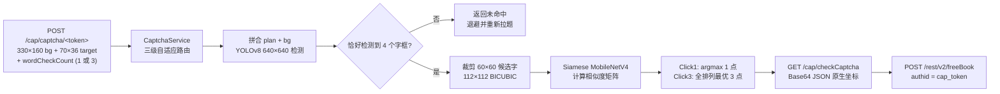

# 验证码识别引擎：YOLOv8 + Siamese

LNU-LibSeat v6.0.0 桌面端与移动端共用的本地离线 ONNX 验证码识别管线说明。

[← 返回首页](../README.md) · [架构文档](ARCHITECTURE.md) · [纯 API 协议契约](API_PROTOCOL_CONTRACT.md) · [移动端构建](MOBILE_GUIDE.md) · [数字参数](NUMERIC_PARAMETERS.md)

> [!NOTE]
> 本文及部分源码文件名中的 **`yolo4`**（如 `core/captcha_yolo4_siamese.py`）是早期实验代号，不是架构版本。实际检测模型是 [Ultralytics YOLOv8](https://github.com/ultralytics/ultralytics)，匹配网络是 MobileNetV4-Conv-Medium；保留旧文件名只是为了兼容。

---

## 目录

- [两类验证码与全仓 5 模型清单](#-两类验证码与全仓-5-模型清单)
- [v6 纯 API 全链路推理管线](#-v6-纯-api-全链路推理管线)
- [三级自适应路由（告别硬时间窗）](#-三级自适应路由告别硬时间窗)
- [YOLOv8 检测层](#-yolov8-检测层)
- [Siamese 相似度层](#-siamese-相似度层)
- [登录 4 位图形码（ddddocr_lite）](#-登录-4-位图形码ddddocr_lite)
- [移动端零误差对齐（CPU 解码 + Pillow 定点重采样）](#-移动端零误差对齐cpu-解码--pillow-定点重采样)
- [模型预热、线程安全与性能实测](#-模型预热线程安全与性能实测)
- [自训练与替换模型](#-自训练与替换模型)
- [故障排查](#-故障排查)

---

## 🎯 两类验证码与全仓 5 模型清单

辽大图书馆纯 API 流程涉及两类验证码，全部在本地由 **ONNX Runtime CPU** 离线求解，零云端打码费用：

| 阶段 | 验证码类型 | 说明 | 运行时 ONNX 文件 | 精度 | 体积 |
| :--- | :--- | :--- | :--- | :---: | :---: |
| **登录** | 4 位图形文本码 | `GET /auth/createCaptcha`（160×70 PNG） | `common_old.onnx` (+ `charset_old.json`) | INT8 | `12.98 MiB` |
| **预约（非高峰）** | **Click1** 单字点选 | `wordCheckCount == 1`，返回 1 个 `(x, y)` | `click1_yolo_plan_bg_char40_best.onnx` | FP32 | `11.70 MiB` |
| **预约（非高峰）** | **Click1** 相似度匹配 | MobileNetV4 1×4 相似度 argmax | `click1_siamese_yolo4_best.onnx` | FP32 | `42.39 MiB` |
| **预约（06:30 高峰）** | **Click3** 三字按序点选 | `wordCheckCount == 3`，返回 3 个有序 `(x, y)` | `click3_yolo_plan_bg_char60_best.onnx` | FP32 | `42.67 MiB` |
| **预约（06:30 高峰）** | **Click3** 相似度匹配 | MobileNetV4 3×4 相似度全排列最优匹配 | `click3_siamese_yolo4_posw3_best.onnx` | FP32 | `42.39 MiB` |

- **桌面端位置**：点击 4 模型位于 `core/checkpoints/*.onnx`（共 `139.15 MiB`），登录 OCR 在发行包中位于 `_internal/ddddocr_lite/`（源码开发态直接读取已安装 `ddddocr` 包内文件，零 OpenCV 依赖）。
- **移动端位置**：全部 5 个原版无损 ONNX 模型由 `scripts/prepare_mobile_assets.py` 导出至 `mobile/assets/models/`（共 **`159.52 MB` / `152.13 MiB`**，自动校验 `IR <= 8`、`Opset <= 18` 兼容移动版 ONNX Runtime 1.15.1）。

---

## 🔄 v6 纯 API 全链路推理管线

v6 已彻底移除浏览器 DOM 抓图与 Selenium `ActionChains` 模拟点击，直接处理接口原始图像字节流并 1:1 回传原生像素坐标：

### 关键代码位置（桌面 Python ↔ 移动 Dart 一一对应）

| 阶段 | 桌面端（Python） | 移动端（Flutter / Dart） |
| :--- | :--- | :--- |
| 统一服务与路由 | `core/captcha_service.py` (`CaptchaService`) | `mobile/lib/core/captcha/captcha_service.dart` |
| 独立后台推理线程 | `CaptchaService._lock` 共享单例 | `mobile/lib/core/captcha/onnx_worker.dart` (Isolate) |
| YOLOv8 ONNX 检测 | `core/yolo_onnx.py` (`YoloOnnxPredictor`) | `mobile/lib/core/captcha/yolo_onnx.dart` |
| Click1 / Click3 求解 | `core/captcha_click1_yolo4_siamese.py` / `core/captcha_yolo4_siamese.py` | `mobile/lib/core/captcha/siamese_onnx.dart` |
| 登录 4 位 OCR | `core/captcha.py` (`_LiteOnnxOcr`) | `mobile/lib/core/captcha/ocr_login.dart` |
| 诊断叠加图 | `core/session_recorder.py` (`save_captcha_diagnostic`) | `mobile/lib/core/session_recorder.dart` |

---

## 🧭 三级自适应路由（告别硬时间窗）

> 与 v5 硬编码「仅 06:30–06:35 启用本地模型」不同，**v6 全天候 24 小时均可自动解 Click1 与 Click3 验证码**。

源码：`core/captcha_service.py:detect_captcha_kind()`（与 Dart 端一致）按以下三级优先级判定题型：

1. **一级（最优先）：服务端显式字段 `wordCheckCount`**
   - `/cap/captcha` 返回 `wordCheckCount == 3` → 路由 `click3`；`wordCheckCount == 1` → 路由 `click1`。
2. **二级（图像特征兜底）：目标图槽位笔迹占空比**
   - 将 `70×36` 目标图转灰度（`L`），检测 `y=[5:27]` 处左/中/右三个槽位（`x=[5:25], [25:45], [45:65]`）中灰度 `< 180` 的深色像素占比：
   - 左右槽均 `>= 2%` → `click3`；
   - 仅中槽 `>= 2%` 且左右槽均 `< 1%` → `click1`。
3. **三级（最后兜底）：北京时间窗口**
   - 前两级均无法判定时，北京时间 `06:30:00–06:35:00`（`RUSH_WINDOW_START/END`）走 `click3`，其余时段走 `click1`。

---

## 🔍 YOLOv8 检测层

源码：`core/yolo_onnx.py` + `core/captcha_*_yolo4_siamese.py`

| 参数 | Click1 | Click3 | 说明 |
| :--- | :---: | :---: | :--- |
| 模型输入尺寸 (`yolo_imgsz`) | `640×640` | `640×640` | Pillow `BILINEAR` 等比缩放 + 居中填充 |
| letterbox 填充色 | `114` | `114` | YOLO 标准深灰 |
| 置信度阈值 (`yolo_conf`) | `0.05` | `0.05` | 低于则过滤 |
| NMS IoU 阈值 (`yolo_iou`) | `0.7` | `0.45` | 同类去重阈值 |
| `max_det` | `300` | `300` | NMS 后保留上限 |
| 候选数硬门槛 (`top_k`) | 必须 `== 4` | 必须 `== 4` | 检测数不为 4 直接放弃本图并刷新重取，宁缺毋滥 |
| 候选裁剪边长 (`char_crop_size`) | `60 px` | `60 px` | 以框中心向外裁剪 60×60 区域送入 Siamese |

---

## 🧬 Siamese 相似度层

- **网络架构**：`SiameseMobileNetV4Embed`（骨干 `timm.mobilenetv4_conv_medium`，输入 `112×112` RGB，经 Pillow `BICUBIC` 等比缩放并居中填充灰度 `128`，像素归一化至 `[0, 1]`，CHW 排布）。
- **推理匹配**：
  - **Click1**：1 个目标字 × 4 个背景候选（batch=4）→ 取相似度 `argmax` 输出 1 个 `(x, y)` 整数坐标。
  - **Click3**：3 个有序目标字 × 4 个背景候选（batch=12）→ 构造 `3×4` 相似度矩阵，在 `_optimal_match()` 中枚举全部 $P(4,3) = 24$ 种无重复排列求总分最高解，要求全部 3 点均有效匹配。

---

## 🔤 登录 4 位图形码（`ddddocr_lite`）

源码：`core/captcha.py`（桌面） / `mobile/lib/core/captcha/ocr_login.dart`（移动）

- **纯 Pillow + ONNX，零 OpenCV**：将 160×70 登录图形码按 `target_height = 64` 等比 `LANCZOS` 缩放后转灰度（`L`），归一化 `/ 255.0` 送入 `common_old.onnx`，经 CTC Greedy 解码查 `charset_old.json` 输出 4 位验证码。
- **体积优化**：桌面构建脚本（`build.py` / `build_mac.py`）仅提取 `common_old.onnx (13 MB) + charset_old.json`，剔除了未使用的 `common.onnx (52 MB)`、`common_det.onnx (19 MB)` 与整个 `opencv-python`。

---

## 📱 移动端零误差对齐（CPU 解码 + Pillow 定点重采样）

为保证 Android / iOS 手机端识别率与桌面端完全一致且**息屏锁屏无 GPU 依赖**：

1. **原生纯 CPU 解码**：
   - Android (`MainActivity.kt:decodeImageRgbaCpu`)：`BitmapFactory.decodeByteArray`（`ARGB_8888`, `inScaled=false`, `inPremultiplied=false`），底层与 Pillow 同用 `libjpeg-turbo / libpng`；
   - iOS (`AppDelegate.swift:decodeImageRgbaCpu`)：`ImageIO` + `CoreGraphics` 渲染到 8-bit sRGB `CGContext`。
2. **Pillow 算子逐字节移植（`mobile/lib/core/captcha/pil_image_ops.dart`）**：
   - 严格复现 Pillow 22-bit 定点系数与取整逻辑的 `BILINEAR`（YOLO）、`BICUBIC`（Siamese）、`LANCZOS`（登录 OCR）重采样，以及 ITU-R 601-2 灰度转换公式；
   - 由 `scripts/dump_test_vectors.py` 生成黄金向量，`flutter test` 执行 **SHA-256 逐字节 0 误差校验**。

---

## 🧊 模型预热、线程安全与性能实测

- **异步预热**：桌面端 `logic/orchestrator.py:start_captcha_model_preload()` 在 GUI/CLI 启动时以守护线程预热 Click3 + Click1（约 2 秒）；移动端在独立 Isolate 预热，均避免 06:30 首次冷启动。
- **线程安全**：桌面端由 `CaptchaService._lock` 保护双账号并发调用，仅共享一份 ONNX Runtime 上下文；移动端单 Isolate 串行排队，内存占用可控。
- **实测性能**：
  - 本地单次 Click1 推理：**~62 ms**（纯 CPU，非高峰全链路从锁定空座到 `freeBook` 下单实测 **~0.55 s**）；
  - 06:30 高峰 Click3 推理同样为毫秒级，但在 `booker` 编排层会主动对齐官网服务端反作弊时间窗（`1.55s` 最小求解间隔 + `2.05s` 校验后缓冲 + `6.20s` 再次取码冷却），保证高过检率并避免触发滑动窗口频控；
  - Click1 测试集端到端一次准确率：**83.48%**（YOLO 覆盖率 100%，单座最多重试 8 次，累计通过率极高）。

---

## 🧪 自训练与替换模型

完整数据采集、标注、YOLOv8 检测训练、Siamese MobileNetV4 对比/三元组训练及 ONNX 导出脚本位于仓库 [`train/`](../train/README.md) 与 [`model/`](../model/README.md)：
1. 训练导出新 ONNX 后覆盖 `core/checkpoints/` 对应文件即可用于桌面端；
2. 运行 `python scripts/prepare_mobile_assets.py`（或 `python build_android.py --prepare-only`）即可同步检查 IR/Opset 兼容性并更新至移动端 `mobile/assets/models/`。

---

## 🛠️ 故障排查

<b>Q1: 桌面端日志提示模型加载失败？</b>

- **发行包用户**：核对 `_internal/core/checkpoints/` 下 4 个 `*.onnx` 文件（共约 `139 MiB`）与 `_internal/ddddocr_lite/` 下 `common_old.onnx` + `charset_old.json` 是否完整，切勿被杀毒软件误删。
- **源码用户**：确认 `core/checkpoints/` 存在 4 个 `.onnx` 且已安装 `onnxruntime>=1.17.0`（请安装 CPU 版，无 CUDA 机器装 GPU 版会更慢或报错）。

<b>Q2: 某次抢座点选未通过怎么复盘？</b>

- **桌面端**：打开 `logs/sessions/<时间戳>_<学号>/*_captcha_*.png`，图中直接叠加绘制了目标字、背景图、YOLO 检测绿圈与最终点击红点。
- **手机端**：进入 **「我的 ▸ 运行记录与识图回放」** 可直接可视化回看每次推理的红绿点与耗时。

<b>Q3: 移动端为什么默认不开启 FP16 压缩？</b>

Flutter `onnxruntime: ^1.4.1` 内置 ONNX Runtime 1.15.1，部分算子（如 `ReduceMax`）缺乏 FP16 内核实现；因此 `scripts/prepare_mobile_assets.py` 默认导出**原版无损 FP32 / INT8**，以约 159.5 MB 体积换取与桌面端 100% 一致的识别精度和零算子报错。

