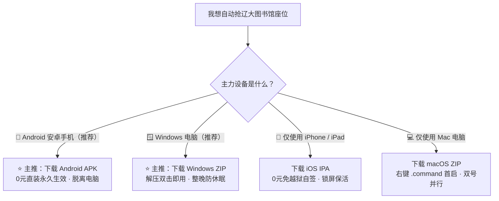

<div align="center">

# ⚡ 全平台快速上手指南

### 🎯 30 秒选对版本，从零完成第一次 0.55 秒纯 API 抢座

[← 返回 README](../README.md) ·
[🤖 Android 直装与保活教程](ANDROID_INSTALL_GUIDE.md) ·
[📱 手机独立版全览](../mobile/README.md) ·
[🍎 iOS 零元安装教程](IOS_INSTALL_GUIDE.md) ·
[⚙️ 配置详解](CONFIGURATION.md) ·
[📦 v6.0.0 发布说明](RELEASE_NOTES_V6.md)

</div>

---

## 🤔 第一步：选一个最适合你的版本

**v6.0.0 已彻底移除浏览器与 WebDriver 依赖，四端共用同一套纯 HTTP API 引擎与本地无损 ONNX 识图模型：**



| 推荐档位 | 平台 | 安装包（[GitHub Releases](https://github.com/XUNRANA/LNU-LibSeat-Automation/releases/latest)） | 核心前提 |
| :--- | :--- | :--- | :--- |
| **🏆 主力推荐** | **Android 手机** | `LNU-LibSeat-Android-arm64.apk` (`165.9 MB`) | Android 7.0+ (64位)，能访问 `libseat.lnu.edu.cn` |
| **🏆 主力推荐** | **Windows 电脑** | `LNU-LibSeat-v6.0.0-Windows-x86_64.zip` (`204.6 MB`) | Windows 10/11，**无需 Python、无需浏览器驱动** |
| 🍎 苹果生态 | **iPhone / iPad** | `LNU-LibSeat-iOS-arm64-unsigned.ipa` (`146.7 MB`) | iOS 15.0+，普通免费 Apple ID 即可自签 |
| 🍎 苹果生态 | **macOS 电脑** | `LNU-LibSeat-v6.0.0-macOS-arm64.zip` (`193.6 MB`) | macOS Apple Silicon，**无需 Chrome / Safari 驱动** |

---

## 🤖 主线一：Android 手机版 30 秒上手（主力推荐）

> 想彻底脱离电脑、随时查全馆 21 室空座、自动收签到防违约提醒？首选 Android 版。完整分品牌防锁屏冻结步骤见 **[Android 直装与保活教程](ANDROID_INSTALL_GUIDE.md)**。

### Step 1️⃣ 下载并安装 APK
1. 手机浏览器打开 [GitHub Releases 最新版本](https://github.com/XUNRANA/LNU-LibSeat-Automation/releases/latest)，下载 **`LNU-LibSeat-Android-arm64.apk`**。
2. 点击安装包完成安装（如微信传输后文件名带 `.1`，去掉 `.1` 后再装；遇国产系统「未知来源 / 未备案提醒」点继续安装即可）。

### Step 2️⃣ 填校园卡与目标自习室
1. 打开桌面 **LNU LibSeat** → 右下角 **「我的 ▸ 校园卡账号」** → 输入学号与密码（初始密码通常为 `000000`）；如需全天免换座，顺手填副账号（如主号 `09:00-15:00`、副号 `15:00-21:00`）。
2. 切回左下角 **「晨约」** → 点目标卡右侧 **`速改 >`** → 选校区、自习室、时段；**首选座位号可留空**（自动抢全室实时空座）。

### Step 3️⃣ 一次性开启隔夜保活（若要睡前设 06:30）
1. 进入 **「我的 ▸ 晨约守夜与后台保活」**，把 **电池优化白名单、精确闹钟、系统通知、锁屏全屏唤醒（Android 14+）** 4 项体检开关全部点亮为绿色。
2. 点页底 **「vivo / 小米 / 华为 / OPPO 专属保活项」**，按品牌打开 **允许后台高耗电 + 自启动 + 后台弹出界面 + 多任务加锁**（详见 [Android 保活教程](ANDROID_INSTALL_GUIDE.md#第二步按手机品牌开启专属-4-项一次性设置)）。

### Step 4️⃣ 开抢 & 2 分钟自测
- **随时捡漏**：切到 **「立即执行」** 点主按钮，或直接切到 **「寻座」** 看 21 室实时空座雷达、进单室网格一键直订绿色空座。
- **06:30 隔夜守夜**：先用 **「当前时间 + 2 分钟」** 锁屏测通一次，再改回 `06:30` 点 **「开启晨约」** 即可锁屏睡觉（期末/考研亦可点首页 **「夜守」** 进入 OLED 纯黑床头模式插电不锁屏）。

---

## 🪟 主线二：Windows 电脑版 30 秒上手（主力推荐）

> 适合电脑挂机与期末无人值守。v6 已彻底移除浏览器与 Selenium，不再弹出浏览器窗口，全程在内置终端里极速完成。

### Step 1️⃣ 下载并解压
前往 [GitHub Releases 最新版本](https://github.com/XUNRANA/LNU-LibSeat-Automation/releases/latest) 下载 **`LNU-LibSeat-v6.0.0-Windows-x86_64.zip`**（`204.6 MB`），解压到任意文件夹。

<p align="center">
  
</p>

### Step 2️⃣ 双击启动 `LNU-LibSeat.exe`
直接双击解压目录中的 `LNU-LibSeat.exe`（v5 老用户可把旧 `config.py` 直接复制到同级目录，废弃浏览器字段会自动静默忽略）。

### Step 3️⃣ 填写配置表单

<p align="center">
  
</p>

| 区域 | 填什么 |
| :--- | :--- |
| **🎯 目标设置** | 选校区（崇山 / 蒲河）、自习室；首选座位最多填 10 个，**v6 允许全部留空**（自动实时拉取当前空座） |
| **👤 账号设置** | 填学号 + 密码（初始密码 `000000`）；勾选「启用更多账号」可开双号并发（如 `09:00-15:00` + `15:00-21:00` 全天免换座） |
| **📧 通知邮箱 & 📲 手机推送** | 填收件邮箱（免配 SMTP，内置发件箱直发）；v6 新增 **手机推送** 框，支持直接粘贴 Bark / PushPlus / Server酱 / 企微 / 飞书 / 钉钉 Webhook |
| **⚡ 立即执行 / ⏰ 定时执行** | **立即**：当下立刻登录捡漏；**定时**：默认 `06:30`（可改任意时刻），提前 15s 预热、提前 5s 保活校准服务端时钟、准点 `+200ms` 开枪 |

> *进阶提示*：想配置主房满员时自动切备选房（`FALLBACK_ROOMS`），可在同级 `config.py` 中添加，详见 [配置详解](CONFIGURATION.md)。

### Step 4️⃣ 点击「开始抢座」
- 程序启动后会在后台异步预热本地 Click1 + Click3 ONNX 模型（约 2 秒），并自动申请 Windows 系统防休眠权限。
- 抢座全过程不再弹出浏览器，所有状态实时打印在右侧深蓝 `RUN LOG` 终端中。
- 抢中后：📧 邮件 + 📲 手机 Webhook 秒推（含**预约单号与小票凭证**），同时写入 `logs/sessions/<时间戳>_<学号>/`。

---

## 🍎 次线：iPhone (iOS) 与 Mac (macOS) 上手指引

### 📱 iPhone / iPad（iOS 15.0+）
1. 前往 [Releases](https://github.com/XUNRANA/LNU-LibSeat-Automation/releases/latest) 下载 **`LNU-LibSeat-iOS-arm64-unsigned.ipa`**（`146.7 MB`）。
2. 使用 **Sideloadly / 爱思助手 / SideStore / TrollStore** 用免费个人 Apple ID 完成 0 元安装。
3. 首次打开前在系统设置中开启 **开发者模式** 并信任证书；定时抢座开启后内置 **静音锁屏后台保活**（亦支持「银杏夜守」OLED 纯黑床头模式）。
4. 详细分步教程见 👉 **[🍎 iPhone / iOS 零元安装与过夜教程](IOS_INSTALL_GUIDE.md)**。

### 💻 macOS（Apple Silicon）
1. 前往 [Releases](https://github.com/XUNRANA/LNU-LibSeat-Automation/releases/latest) 下载 **`LNU-LibSeat-v6.0.0-macOS-arm64.zip`**（`193.6 MB`）。
2. 解压后，首次**右键**点击 `首次运行请先双击我.command` →「打开」→ 再点「打开」（解除未付费签名拦截；若提示无法打开，去 **系统设置 ▸ 隐私与安全性 ▸ 仍要打开**）；之后直接双击 `LNU-LibSeat.app`。
3. 填表点开始即可——v6 已彻底移除 Chrome / Safari 驱动依赖，**双账号原生并行**，挂机期间自动通过系统 `caffeinate -dimsu` 防休眠，`config.py` 与 `logs/` 位于 `.app` 同级。

---

## 🛠️ 开发者：从 Python 源码运行

<details>
<summary><b>展开查看源码运行与打包命令</b></summary>

```powershell
# 1. 克隆仓库并安装依赖（Python 3.10+，CI 基准 3.12）
git clone https://github.com/XUNRANA/LNU-LibSeat-Automation
cd LNU-LibSeat-Automation
python -m venv .venv
.\.venv\Scripts\activate
pip install -r requirements.txt

# 2. 启动桌面 GUI 或纯 CLI
python gui_qt.py
# 或 python main.py

# 3. 跑全量离线单元测试与 lint
pip install pytest ruff
pytest tests/ -q
ruff check .
```

打包各端发行产物：
- Windows：`python build.py`
- macOS（在 Mac 上）：`python3 build_mac.py`
- Android：`python build_android.py`
- iOS（在 Mac 上）：`python3 build_ios.py`（详见 [MOBILE_GUIDE.md](MOBILE_GUIDE.md)）

</details>

---

## 🛟 常见问题 FAQ

<details>
<summary><b>Q1: v6 还会弹出浏览器吗？需要装 Edge / Chrome / WebDriver 吗？</b></summary>

**完全不会，也完全不需要。** v6 已 100% 切换为纯 HTTP API 引擎，不再依赖任何浏览器与 WebDriver，单账号仅占用极少量内存，从锁定空座到下单实测仅需 `0.55s`。
</details>

<details>
<summary><b>Q2: 点选验证码还需要付费 API 或限制在 06:30–06:35 才能用吗？</b></summary>

**全天候离线免费可用！** v5 时代硬编码的 `06:30–06:35` 时间限制已在 v6 彻底取消。现由 `CaptchaService` 根据服务端 `/cap/captcha` 返回的 `wordCheckCount`（`1` 或 `3`）与目标图槽位笔迹**全天自动路由** Click1 / Click3 本地无损 ONNX 模型，白天错峰捡漏和 06:30 高峰同样秒解（单次推理 ~62ms）。
</details>

<details>
<summary><b>Q3: 抢座失败了怎么排查？logs 目录里有哪些文件？</b></summary>

- **桌面端**打开 `logs/sessions/<时间戳>_<学号>/`：
  - `session.log` — 本次会话完整毫秒级日志
  - `抢座顺序.txt` — 本次实时空座统计与首选/兜底候选列表
  - `http_trace.jsonl` — 自动脱敏的 HTTP 请求/响应流水（密码、Token、Cookie 已抹除）
  - `*_captcha_*.png` — 目标字 + 背景图 + YOLO 候选绿圈 + 点击红点诊断图（`< 50KB`，已取代笨重 MP4 录屏）
- **手机端**打开 **「我的 ▸ 运行记录与识图回放」** 可直接可视化复盘并导出脱敏诊断包。
</details>

<details>
<summary><b>Q4: Windows 电脑整晚挂机会被休眠吗？怎么做到每天定时唤醒？</b></summary>

🛡️ **运行期间不会休眠**：Windows GUI 启动任务时自动调用 `SetThreadExecutionState` 并开启 30 秒防休眠心跳（空闲 ≥ 60 秒执行 1px 微抖动抵消，绕过现代笔记本 S0ix 睡眠）；任务结束自动恢复默认电源策略。

若希望电脑夜间睡眠、次日自动醒来跑桌面版，可用 **Windows 任务计划程序**：
1. `Win + R` 输入 `taskschd.msc` →「创建基本任务」
2. **触发器**：每天 `06:25`（提前 5 分钟唤醒并预热 ONNX 模型足够宽裕）
3. **操作**：启动程序 → 选择 `LNU-LibSeat.exe`（并提前将 `config.py` 设为 `WAIT_FOR_0630 = True`）
4. 「条件」勾选 ✅ **「唤醒计算机以运行此任务」**
</details>

<details>
<summary><b>Q5: 时段该怎么填？双账号怎么配合全天免换座？</b></summary>

- **开始时间**：整点（如 `09:00`）或 `"现在"`（立即模式）
- **结束时间**：**必须为整点**（如 `15:00`、`21:00`），且单次预约最长 **6 小时**（学校官方规则）
- **双账号接力**：例如主号填 `09:00 - 15:00`、副号填 `15:00 - 21:00`。v6 内置 `SeatClaimCoordinator` 会自动识别两段不重叠，**放行双号同抢同一心仪座**；若两号时段重叠，则自动错开兜底座避免内耗。
</details>

<details>
<summary><b>Q6: 桌面发行包里的 ONNX 权重在哪？怎么确认齐全？</b></summary>

- **Windows / macOS 发行包**：点击验证码 4 个权重在 `_internal/core/checkpoints/` 下（仅含 4 个 `*.onnx`，约 `139 MiB`），登录 4 位图形码在 `_internal/ddddocr_lite/` 下（`common_old.onnx` + `charset_old.json`，约 `13 MB`）。
- **Android / iOS 手机端**：全部 5 个原版无损 ONNX 模型已随包打入应用资产（总计 `159.52 MB`），安装即用无需额外下载。
</details>

---

## 📖 下一步阅读

- 🤖 [Android 直装与 06:30 隔夜保活教程](ANDROID_INSTALL_GUIDE.md) — 国产手机防锁屏冻结必看
- 📱 [手机独立版完整说明与 6 张实机图](../mobile/README.md) — 四大频道功能详解
- ⚙️ [桌面端配置详解 (`config.py`)](CONFIGURATION.md) — 多自习室兜底与 Webhook 配置
- 🚀 [v5 → v6 升级指南](MIGRATION_V5_TO_V6.md) — 老用户平滑迁移清单
- 🏗️ [全仓架构文档](ARCHITECTURE.md) — 桌面 Python + 移动 Flutter 双端实现原理

---

<div align="center">

**有问题？** [📮 提 Issue](https://github.com/XUNRANA/LNU-LibSeat-Automation/issues) · **觉得有用？** [⭐ Star](https://github.com/XUNRANA/LNU-LibSeat-Automation) · [☕ 赞助支持](../README.md#-求赞助--支持持续开发)

</div>
