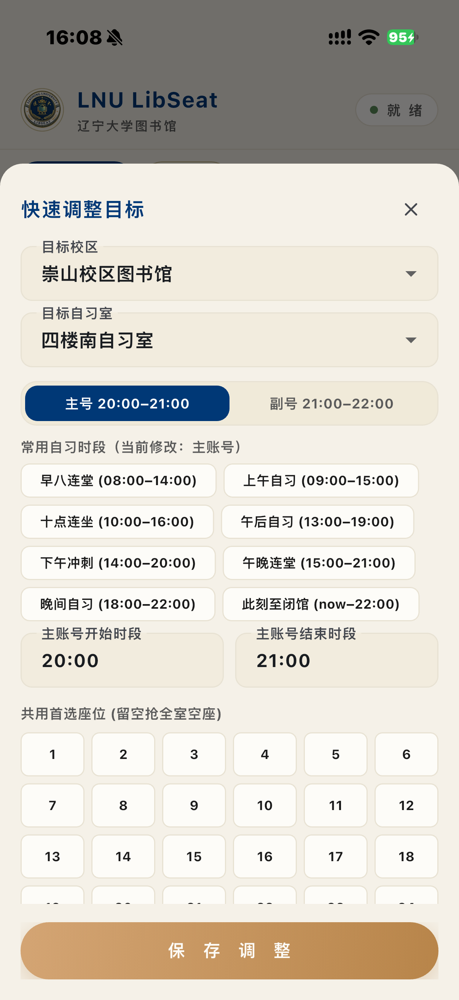

<div align="center">
  
  <h1>LNU-LibSeat Mobile</h1>
  <p>辽宁大学图书馆约座工具 · 手机独立版（主推 Android，同步支持 iOS）</p>
  <p>
    <a href="../docs/ANDROID_INSTALL_GUIDE.md"></a>
    <a href="../docs/IOS_INSTALL_GUIDE.md"></a>
    <a href="../README.md"></a>
  </p>
</div>

手机独立版基于 Flutter 开发，内置与电脑端一样的 5 个原版 ONNX 验证码识别模型和纯 HTTP API 引擎，**不需要开电脑，也不依赖任何第三方服务器**。校园卡号和密码加密存在手机系统安全库（Android Keystore / iOS Keychain）中，只直连 `libseat.lnu.edu.cn`。

> [!WARNING]
> 约到座位请按时到馆刷卡签到。学校规定 7 天内累计 **3 次违约会进黑名单 7 天**。App 约座成功后会自动帮你定系统级签到提醒，请保持通知权限开启。

---

## 实机界面（Android / iOS 完全一致）

两个系统共用同一套 Flutter 界面，分为「晨约 / 寻座 / 入馆 / 我的」四个底部标签：

<div align="center">
<table>
<tr>
<td align="center" width="33%">
<br>
<sub><b>晨约</b>：立即 / 定时表盘、快捷方案、实时日志</sub>
</td>
<td align="center" width="33%">
<br>
<sub><b>速改</b>：校区、主副号时段与首选座位</sub>
</td>
<td align="center" width="33%">
<br>
<sub><b>寻座</b>：崇山 / 蒲河 21 间自习室实时空座</sub>
</td>
</tr>
<tr>
<td align="center" width="33%">
<br>
<sub><b>单室网格</b>：筛选空座 / 标记笔记 / 一键直订</sub>
</td>
<td align="center" width="33%">
<br>
<sub><b>入馆</b>：座签、违约次数、暂离计时与自习记录</sub>
</td>
<td align="center" width="33%">
<br>
<sub><b>我的</b>：双号接力时间轴、备选房与保活体检</sub>
</td>
</tr>
</table>
</div>

---

## 主要功能

1. **晨约（定时 06:30 + 立即捡漏）**
   - 定时模式在 `06:29:45` 提前登录并拉取座位索引，`06:29:55` 保活并二次校准服务端时间，`06:30:00.200` 准点提交（内置 5 秒宽限窗防提前撞墙）。
   - 支持保存常用方案，点首页 `速改 >` 可以直接调校区、自习室、主副号时段（含 8 套快捷预设）和首选座号；首选留空会自动抢全房实时空座。
   - 底部日志抽屉支持按 `全部 / 主号 / 副号` 筛选，方便看每一步执行情况。

2. **寻座（21 间自习室空座雷达 + 单室直订）**
   - 支持切换崇山 / 蒲河校区，直接看全馆总空座和每间自习室剩余座位数。
   - 点进任意自习室可按「全部 / 只看空座 / 宝藏座」筛选或搜座号，点空座自动查当日可约时段，支持一键直接预约。
   - 长按座号可自己记笔记（比如“靠窗有插座”）；房间满员时可以开低频蹲空座（每 60 秒轻查一次，有空位弹通知）。

3. **入馆（电子座签 + 防违约提醒）**
   - 支持按全部 / 主号 / 副号查看当前预约凭证，可直接取消预约。
   - 显示主副号 7 天违约次数（`x / 3`），提供食堂吃饭（55 分钟）/ 短暂离开（25 分钟）暂离倒计时、专注计时，以及馆方公告和历史约座统计。
   - 预约成功后自动注册系统级签到提醒：**开始前 15 分钟**提醒一次，**开始后 20 分钟**（距 30 分钟违约截止剩 10 分钟）急催一次，锁屏或划掉后台也能响。

4. **双号接力与备选房兜底**
   - 在「我的」里配好两个账号时段（如 `09:00–15:00` + `15:00–21:00`），时段不重叠时允许双号抢同一个座位，全天免换座；时段重叠自动错开。
   - 主自习室满员时，按自定义顺延列表自动切到备选自习室。
   - 除了本地通知，同样支持邮箱战报（内置 126 发件箱免配置）和 Bark / PushPlus / 企微等 Webhook 推送。

5. **本地无损 ONNX 识图（与桌面端精度一致）**
   - 内置 5 个原版无损 ONNX 模型（登录 4 位图形码 + Click1/Click3 的 YOLOv8 检测与 MobileNetV4 匹配，共 159.5 MB）。
   - 预处理完整移植了 Python Pillow 的重采样和灰度算法（已通过 SHA-256 逐字节单测校验），Android 用原生 CPU `BitmapFactory`、iOS 用原生 CPU `ImageIO` 解码，在独立 Isolate 推理，息屏后台不依赖 GPU。
   - 在 **我的 → 运行记录与识图回放** 可查看每次验证码的红绿点，支持导出**最近一轮完整日志（含双账号）**或**打包全部历史日志（`.zip`）**；iPhone 也可直接打开系统「文件」App →「我的 iPhone」→「LNU-LibSeat」随时查看。

---

## 安装方式（均在 [GitHub Releases](https://github.com/XUNRANA/LNU-LibSeat-Automation/releases/latest) 下载）

### Android（主推，直接安装永久有效）
1. 下载 **`LNU-LibSeat-Android-arm64.apk`**（165.9 MB，本地运行 `python build_android.py` 产出的 `dist/辽宁大学图书馆座位预约.apk` 是同一个包）。
2. 直接点击安装（未上架应用商店，遇“未知来源 / 未备案”提示点继续安装；后续新版直接覆盖安装，不会丢配置）。
3. 装完后到 **我的 → 晨约守夜与后台保活** 点亮 4 项权限体检，并按手机品牌开启后台白名单。完整分品牌设置见 **[docs/ANDROID_INSTALL_GUIDE.md](../docs/ANDROID_INSTALL_GUIDE.md)**。

### iPhone / iPad（iOS 15.0+，免费自签）
因为未花 99 美元购买苹果开发者年费上架 App Store，发布的是免签名包 **`LNU-LibSeat-iOS-arm64-unsigned.ipa`**（146.7 MB）。完整分步教程见 **[docs/IOS_INSTALL_GUIDE.md](../docs/IOS_INSTALL_GUIDE.md)**，常用方式速览：

| 工具 | 适用情况 | 有效期 | 说明 |
| :--- | :--- | :--- | :--- |
| **Sideloadly / 爱思助手** | 有 Win / Mac 电脑（最省事） | 7 天续签一次 | 插线用普通免费 Apple ID（建议小号）签名装入，到期覆盖重签不丢数据 |
| **SideStore / AltStore** | 想在手机上无线续签 | 7 天（连 Wi-Fi 刷新） | 首次需电脑装好 SideStore，之后手机内导入 IPA 并刷新 |
| **Xcode 真机安装** | 有 Mac 电脑的开发者 | 7 天续签一次 | 打开 `mobile/ios/Runner.xcworkspace`，切 `Release` 模式装机 |
| **TrollStore（巨魔）** | 系统版本支持巨魔的设备 | 永久不过期 | 直接用巨魔导入安装 |

首次打开自签 App 需要在 iPhone **设置 → 隐私与安全性 → 开发者模式** 打开开关，并在 **设置 → 通用 → VPN与设备管理** 信任你的 Apple ID 证书。

---

## 睡前设好 06:30 怎么防系统杀后台？

手机系统夜间都会限制后台耗电，**睡前过夜请留意以下两点**：

- **Android**：
  - App 已内置前台常驻通知、动态 WakeLock + WifiLock、系统闹钟唤醒（提前 20 秒主闹钟 + 预热时刻副闹钟）、Android 14 锁屏强拉起，以及被杀/重启自恢复。
  - **关键一步**：国产系统（vivo / 小米 / 华为 / OPPO）必须先在系统设置里打开本 App 的 **允许后台高耗电 / 自启动 / 后台弹出界面 / 锁屏显示** 并给多任务卡片加锁，否则锁屏十几秒仍会被系统冻结。配好后建议先设“当前时间 + 2 分钟”锁屏自测一次。详细路径见 [Android 保活教程](../docs/ANDROID_INSTALL_GUIDE.md)。
- **iPhone**：
  - 启动定时后日志出现 `已激活 iOS 锁屏后台保活` 即可直接按电源键锁屏（内置静音后台音频保活，不打断听歌，抢完自动关）；过夜期间不要上滑划掉 App、不要开低电量模式、不要切去玩大型游戏，建议插上充电线。
- **双端通用兜底（夜守时钟）**：
  - 期末周或考研等关键日子，可以直接点首页 **夜守** 切到纯黑时钟界面（每分钟微移防 OLED 烧屏），插着电不锁屏放床头，App 始终保持在前台最稳妥。

---

## 本地编译与测试（开发者）

<details>
<summary><b>展开查看 Android / iOS 本地打包命令</b></summary>

前置环境：Python 3.10–3.12（安装 `numpy`、`onnxruntime`、`onnx`、`Pillow`、`pycryptodome`、`requests`、`ddddocr`）+ Flutter 3.22+（编译 Android 需 Android SDK；编译 iOS 需 macOS + Xcode + CocoaPods）。

```bash
# 打包 Android APK（输出 dist/辽宁大学图书馆座位预约.apk）
python build_android.py

# 在 Mac 上打包免签名 iOS IPA（输出 dist/LNU-LibSeat-iOS-arm64-unsigned.ipa）
python3 build_ios.py

# 单独运行移动端 20 项跨语言与界面单测
cd mobile && flutter pub get && flutter test
```

详细架构与构建机制见 [docs/MOBILE_GUIDE.md](../docs/MOBILE_GUIDE.md)。

</details>

---

[← 返回主 README](../README.md) · [Android 安装与保活](../docs/ANDROID_INSTALL_GUIDE.md) · [iOS 免费安装](../docs/IOS_INSTALL_GUIDE.md) · [移动端构建说明](../docs/MOBILE_GUIDE.md)
