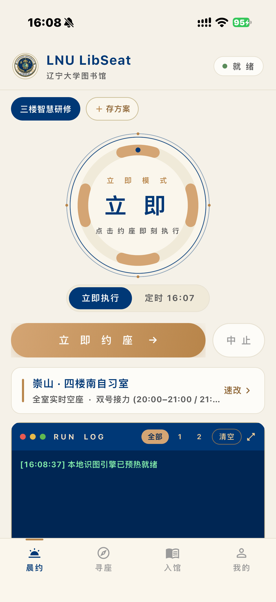
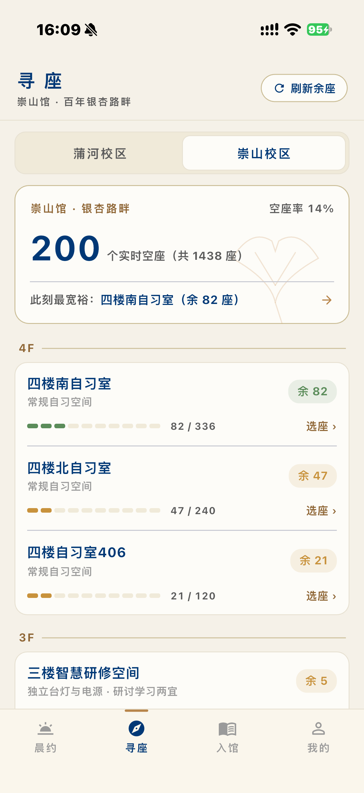
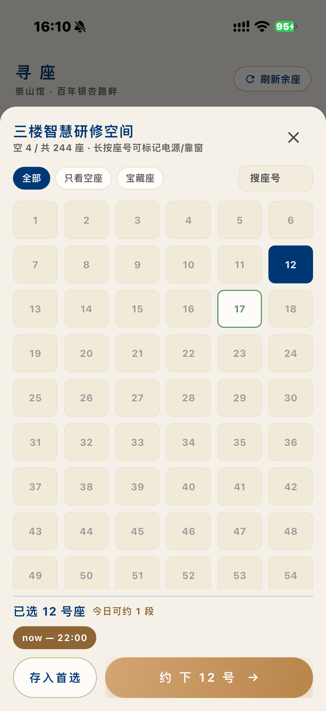
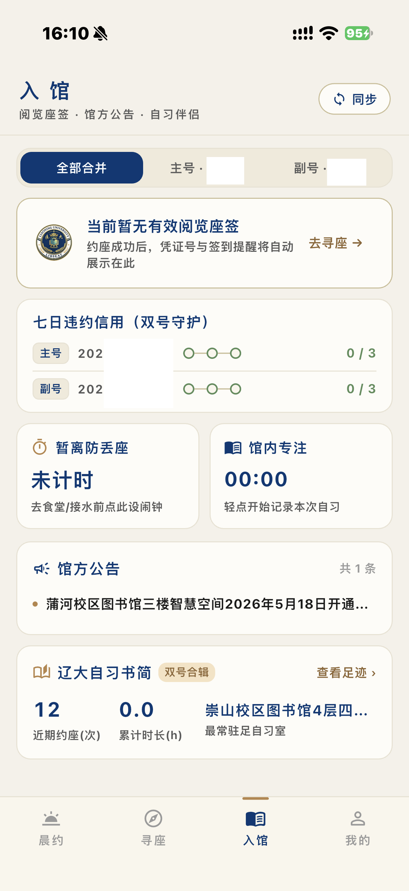
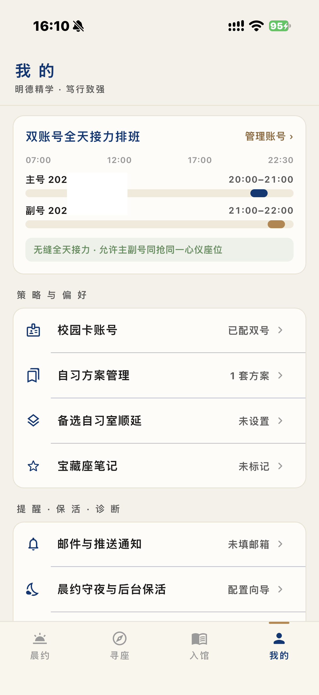

<div align="center">

<table border="0" cellpadding="0" cellspacing="0">
<tr>
<!-- Logo -->
<td width="220" align="center" valign="middle">

</td>
<!-- 标题 + 标语 + 徽章 -->
<td colspan="3" valign="middle">

<h1 align="left">LNU-LibSeat Mobile</h1>

<h3 align="left">📱 辽宁大学图书馆 · 智能抢座神器 · 手机独立版（主推 Android · 同步支持 iOS）</h3>

<p align="left"><strong>100% 脱离电脑 · 零服务器成本 · 纯 HTTP API 毫秒级直连 · 端侧 5 个原版无损 ONNX 识图</strong></p>

<p align="left">
<a href="../docs/ANDROID_INSTALL_GUIDE.md"></a>
<a href="../docs/IOS_INSTALL_GUIDE.md"></a>
<a href="https://flutter.dev"></a>
<a href="https://onnxruntime.ai/"></a>
<a href="../README.md"></a>
<a href="#-免责声明"></a>
</p>

</td>
</tr>
<!-- 核心特性统计行 -->
<tr>
<td align="center" width="240" height="145"><h1>⚡</h1><b>0.55s</b> 纯 API 核心下单<br>服务端时钟毫秒级校准</td>
<td align="center" width="240" height="145"><h1>🧠</h1><b>5 个无损 ONNX</b> 本地推理<br>与电脑桌面端同源同精度</td>
<td align="center" width="240" height="145"><h1>🌙</h1><b>双端锁屏保活</b> + 银杏夜守<br>睡前设好 06:30 准点开抢</td>
<td align="center" width="240" height="145"><h1>0 元</h1>纯端侧离线零服务器<br>Android 直装 · iOS 免费自签</td>
</tr>
</table>

</div>

---

> [!IMPORTANT]
> **手机端与桌面端（[电脑桌面版 README](../README.md)）核心协议、5 个 ONNX 验证码模型权重、图像预处理算子 100% 同源对齐**，无需搭建任何中转服务器，所有校园卡凭据均加密存储在系统安全库（Android Keystore / iOS Keychain）中，仅在手机本地直连 `libseat.lnu.edu.cn`。

---

> [!WARNING]
> 🛡️ **请务必准时到馆刷卡签到！** 辽大图书馆规定 7 天内累计 **3 次违约将进入黑名单 7 天**。App 预约成功后会自动为你注册系统级防违约提醒，也请留意手机通知权限。

---

## 🖼️ 实机界面一览（Android / iOS 界面 1:1 通用）

Android 与 iOS 共用同一套 Flutter 代码与界面设计（下示实机截图双端完全一致），采用辽大专属**「辽大蓝 · 暖米纸底 · 崇山银杏金」**书卷视觉语言，覆盖「**晨约 · 寻座 · 入馆 · 我的**」四大核心频道：

<div align="center">

<table>
<tr>
<td align="center" width="33%">
<br>
<b>① 晨约 · 抢座总控台</b><br>
<sub>立即 / 定时圆环表盘 · 快捷方案 · 实时终端日志</sub>
</td>
<td align="center" width="33%">
<br>
<b>② 速改 · 目标与双号时段</b><br>
<sub>8 套常用自习时段 · 主副号独立时段 · 座号网格</sub>
</td>
<td align="center" width="33%">
<br>
<b>③ 寻座 · 双校区实时雷达</b><br>
<sub>崇山 / 蒲河 21 间自习室实时空座率与楼层排行</sub>
</td>
</tr>
<tr>
<td align="center" width="33%">
<br>
<b>④ 单室可视化选座与直订</b><br>
<sub>只看空座 / 宝藏座筛选 · 查可约时段 · 一键约下</sub>
</td>
<td align="center" width="33%">
<br>
<b>⑤ 入馆 · 座签与自习伴侣</b><br>
<sub>双号违约守护 · 暂离防丢座 · 专注计时 · 自习书简</sub>
</td>
<td align="center" width="33%">
<br>
<b>⑥ 我的 · 双号接力与保活</b><br>
<sub>07:00–22:30 接力时间轴 · 备选顺延 · 通知与保活</sub>
</td>
</tr>
</table>

</div>

---

## ✨ 功能特色详解

### 1. 🎯 晨约总控台（准点秒抢 + 随时捡漏）
- **双模式一键切换**：支持「**立即执行**」（随时捡漏）与「**定时预约**」（默认 `06:30`，可自定义任意时刻）。
- **三段式精准时间轴**：
  - 提前 **15 秒**（`06:29:45`）：自动预热登录、解析目标自习室与全房实时座号索引；
  - 提前 **5 秒**（`06:29:55`）：保活心跳 + 通过 HTTP `Date` 响应头二次校准图书馆服务端时钟；
  - 准点 **`06:30:00.200`**：按校准后的服务端时间毫秒级开抢，内置开馆宽限窗口防提前撞墙。
- **快捷方案 & 速改面板**：支持将常用校区/自习室/时段存为一键切换方案；点 `速改 >` 可在首页直接微调校区、主副号时段（含早八连堂、上午自习、午晚连堂、此刻至闭馆等 8 套快捷预设）与共用首选座号（**留空即抢全室实时空座**）。
- **实时终端日志（`RUN LOG`）**：macOS 终端风格彩色日志抽屉，支持按 `全部 / 主号(1) / 副号(2)` 过滤、一键清空与全屏展开。

### 2. 🧭 双馆实时寻座雷达（错峰捡漏神器）
- **全馆余座秒级总览**：支持**崇山校区**与**蒲河校区**一键切换，实时展示全馆总空座数、空座率、此刻最宽裕自习室推荐，以及按楼层分组的 21 间自习室进度条与设施标签（如独立台灯与电源等）。
- **可视化座号矩阵 + 一键直订**：点进任意自习室即可按「**全部 / 只看空座 / 宝藏座**」或座号搜索定位座位；点击空座自动查询当日可约时段，支持 **一键存入首选** 或 **直接约下该座**。
- **长按标记「宝藏座笔记」**：长按任意座号可备注「有电源 / 靠窗 / 安静」等个人偏好，后续寻座一键筛选。
- **满员房间低频蹲空座**：心仪房间暂满时，可开启合规低频监测（每 60 秒轻查一次），出现空位立即发通知提醒。

### 3. 📖 入馆伴侣与违约守护
- **电子阅览座签**：支持「**全部合并 / 主号 / 副号**」三种视角查看当前生效预约，展示凭证号、时段与座位，支持**一键取消预约**与**签到提醒开关**。
- **七日违约信用（双号守护）**：直观展示主副号 `0 / 3` 违约进度环，提前预警防黑名单。
- **馆内双计时工具**：
  - **暂离防丢座**：去食堂吃饭（55 分钟）或接水/卫生间（25 分钟）前一键设闹钟，防止超期自动退座；
  - **馆内专注计时**：内置自习专注计时器。
- **馆方公告 & 辽大自习书简**：同步图书馆最新官方公告，并自动汇总双号近期约座次数、累计自习时长、最常驻足自习室与历史足迹。

### 4. 👥 双账号全天接力 & 多层兜底策略
- **双账号无缝接力**：在「我的」页以 `07:00–22:30` 时间轴直观编排主副号时段（例如主号 `09:00–15:00` + 副号 `15:00–21:00`），两段不重叠时**自动允许主副号同抢同一心仪座位，全天免换座**；同时段并发则自动防撞座。
- **备选自习室顺延**：主目标自习室满员时，按自定义顺延列表自动切换下一间备选房间，最大程度保底有座。
- **多通道战报 & 防违约提醒**：预约成功后自动推送本地系统通知，并可自动注册「开始前 15 分钟 / 签到截止前 10 分钟」系统级防违约提醒（锁屏/划掉后台均能准时响）；还支持配置**邮箱战报**与**手机 Webhook**（Bark / PushPlus / 企业微信等）。

### 5. 🧠 端侧原版无损 ONNX 验证码识别（零误差对齐电脑端）
- **5 个原版无损模型随包离线内置**（共 `159.52 MB`，零云端打码费）：
  - 登录 4 位图形验证码：`common_old.onnx`（`ddddocr` INT8）
  - 单字点选（Click1）：`click1_yolo_plan_bg_char40_best.onnx` + `click1_siamese_yolo4_best.onnx`（FP32）
  - 三字点选（Click3，06:30 高峰）：`click3_yolo_plan_bg_char60_best.onnx` + `click3_siamese_yolo4_posw3_best.onnx`（FP32）
- **逐像素算子对齐**：完整移植 Python Pillow 22-bit 定点 `BILINEAR / BICUBIC / LANCZOS` 重采样与 ITU-R 601-2 灰度公式，通过 19 项跨语言契约与界面单测（SHA-256 逐字节 0 误差校验）；Android 走原生 CPU `BitmapFactory`、iOS 走原生 CPU `ImageIO + CoreGraphics`，全程在后台独立 Isolate 推理，不卡 UI、息屏不依赖 GPU，**识别率与桌面端基本一致**。
- **识图回放与诊断**：在「我的 ▸ 运行记录与识图回放」可查看每次验证码的 YOLO 候选框、最终点击红点与耗时，支持一键导出脱敏诊断日志。

---

## 📦 安装指南（Android & iOS · 0 元免费）

> 安装包均发布在仓库 [GitHub Releases](https://github.com/XUNRANA/LNU-LibSeat-Automation/releases/latest)（或自行通过下方开发者命令本地编译）。

### 🤖 Android（安卓手机 · 🏆 主力推荐，0 元直装、永久生效）
1. 前往 [GitHub Releases](https://github.com/XUNRANA/LNU-LibSeat-Automation/releases/latest) 下载 **`LNU-LibSeat-Android-arm64.apk`**（约 `165.9 MB`，ARM64 独立离线包，已内置全部 5 个无损 ONNX 模型；本地编译产物名为 `dist/辽宁大学图书馆座位预约.apk`）。
2. 在手机上直接点击安装（若提示「未知来源应用 / 未备案风险提醒」，允许并继续安装即可；后续升级直接覆盖安装，不丢配置，**无 7 天过期限制**）。
3. 首次打开后，强烈建议立即进入 **「我的 ▸ 晨约守夜与后台保活」** 点亮 4 项体检开关，并对照品牌完成一次性防锁屏冻结设置，详细分品牌图文步骤见 👉 **[🤖 Android 直装与 06:30 隔夜保活教程](../docs/ANDROID_INSTALL_GUIDE.md)**。

### 🍎 iPhone / iPad（iOS 15.0+，无需越狱、无需付费账号）

由于本项目为免费开源工具，未购买付费企业签名，iOS 分发标准免签名安装包 **`LNU-LibSeat-iOS-arm64-unsigned.ipa`**。详细分步图文操作与避坑 FAQ 请查看 👉 **[🍎 iPhone / iOS 零元免费安装教程](../docs/IOS_INSTALL_GUIDE.md)**，核心方式速览：

| 安装方式 | 适合人群 | 有效期与特点 | 操作简述 |
| :--- | :--- | :--- | :--- |
| **1. Sideloadly / 爱思助手** | 有 Windows 或 Mac 电脑的同学（最简单） | 免费 Apple ID 签名，**7 天续签一次**（覆盖重签不丢数据） | 数据线连电脑 → 导入 `.ipa` → 输入个人 Apple ID（可用小号）→ 点安装 |
| **2. SideStore / AltStore** | 想在手机上无线自动续签 | 首次需电脑装 SideStore，后续**连 Wi-Fi 即可自动续签** | 在 SideStore 内导入 `.ipa` 即可，到期前点刷新或自动续签 |
| **3. Xcode 真机直装** | 有 Mac 电脑的同学/开发者 | 免费 Apple ID (`Personal Team`)，7 天有效 | Xcode 打开 `mobile/ios/Runner.xcworkspace` → `Signing & Capabilities` 选个人账号 → Run 选 `Release` → 连手机点 `▶` |
| **4. TrollStore（巨魔商店）** | 系统版本支持巨魔的设备 | **永久有效、永不过期** | 直接在 TrollStore 导入 `.ipa` 点击安装 |

> [!TIP]
> **iPhone 首次打开自签 App 必做两步**：
> 1. **开启开发者模式**（iOS 16+）：打开 iPhone **设置 ▸ 隐私与安全性 ▸ 开发者模式**（最底部）→ 打开并按提示重启；
> 2. **信任开发者证书**：打开 iPhone **设置 ▸ 通用 ▸ VPN与设备管理** → 点你的 Apple ID → 点 **「信任」**，返回桌面即可正常打开。

---

## 🚀 30 秒上手使用教程

1. **填写校园卡账号**
   - 打开 App，切到右下角 **「我的」** → 点 **「校园卡账号」** → 输入学号与密码（初始密码通常为 `000000`），如需全天无缝自习可一并配置副账号。密码会加密写入系统安全库，点保存。
2. **设定目标自习室与时段**
   - 切回左下角 **「晨约」** → 点目标卡片右侧的 **`速改 >`** → 选择校区（崇山 / 蒲河）、自习室、起止时段与首选座号（不选座号则自动抢全室空座），点 **「保存调整」**。
   - 若担心主房间满员，可到 **「我的 ▸ 备选自习室顺延」** 添加 1~3 个候补自习室。
3. **启动抢座**
   - **立即捡漏**：顶部切换到 **「立即执行」** → 点 **「立即约座 →」**，或直接切到 **「寻座」** 挑一个绿色空座点击 **「约下 XX 号 →」**。
   - **睡前设好次日 06:30 准点抢**：顶部切换到 **「定时 06:30」** → 点主按钮启动（按下方保活指南放置手机即可安心睡觉）。

---

## ⏰ 睡前设置好，次日 06:30 如何确保准时开抢？

手机操作系统都会在夜间限制后台耗电，**请务必按对应系统做好保活**：

### 🤖 Android 过夜指南（5 重隔夜防杀 + 锁屏解冻，详见 [保活教程](../docs/ANDROID_INSTALL_GUIDE.md)）
- **内置 5 重防杀机制**：前台常驻守夜通知（`IMPORTANCE_DEFAULT` 静音通道）+ 动态 26 小时 CPU `WakeLock` + `WifiLock` 防息屏断网 + `AlarmClock`（提前 20 秒）与预热轻推双闹钟 + Android 14 `MODE_BACKGROUND_ACTIVITY_START_ALLOWED` / `CATEGORY_ALARM` 锁屏全屏强制解冻 + 进程被杀冷启动复活 / 手机夜间重启自恢复。
- **国产 ROM 必做准备（一次性设置，防锁屏墓碑冻结）**：
  1. 在 **「我的 ▸ 晨约守夜与后台保活」** 将 **电池优化白名单、精确闹钟、系统通知、锁屏全屏唤醒（Android 14+）** 4 项全部点亮为绿色；
  2. 点击页底 **「vivo / 小米 / 华为 / OPPO 专属保活项」**，在系统设置中开启 **允许后台高耗电 + 自启动 + 后台弹出界面 + 锁屏显示**，并在最近任务界面给本 App **加锁**。
- 完成以上配置后**可直接锁屏息屏睡觉**（建议先用「当前时间 + 2 分钟」锁屏自测一次；期末/考研同样支持开启 **「银杏夜守」** 插电不锁屏作 100% 物理级双保险）。

### 🍎 iPhone 过夜指南（双保险方案）
- **方案 A：内置「iOS 锁屏后台静音保活」（已自动启用，可按电源键锁屏）**
  - 本 App 针对免审核自签版本内置了 `UIBackgroundModes: audio` 极低功耗全零静音保活（不打断你听歌/刷视频、抢完自动关闭释放）+ 纯 CPU `ImageIO` 图像解码（息屏不依赖 Metal GPU）。
  - 启动定时后日志出现 `🌙 已激活 iOS 锁屏后台保活` 即可直接按电源键锁屏或切微信；
  - **重要注意事项**：
    1. **切勿**在多任务界面上滑强杀 App；
    2. 锁屏过夜期间**不要再去玩大型游戏或长时间录视频**（避免内存吃紧触发 iOS Jetsam 强杀后台）；
    3. 建议睡前关闭「低电量模式」与系统「自动安装软件更新」，并插上充电线。
- **方案 B：「银杏夜守」OLED 纯黑床头模式（期末/考研 100% 绝对稳妥）**
  - 在首页点 **「夜守」**（或在「我的 ▸ 晨约守夜与后台保活」进入），手机自动进入纯黑 `#000000` 极微光书桌时钟（每分钟像素级缓移防烧屏，自动常亮不锁屏）。
  - **插上充电线直接放床头，不要按电源键锁屏**——App 始终处于 iOS 最高优先级前台，绝不会被系统冻结或误杀，次日 `06:29:45` 自动预热、`06:30:00.200` 毫秒级落座。

---

## ⚖️ 四端能力对比（Android / Windows 主力 · iOS / macOS 同步支持）

| 能力维度 | 🤖 Android 独立版（🏆 主力） | 🪟 Windows 桌面版（🏆 主力） | 🍎 iOS 独立版 | 💻 macOS 桌面版 |
| :--- | :--- | :--- | :--- | :--- |
| **抢座核心协议与速度** | 纯 HTTP API（~0.55s） | ✅ 完全一致 | ✅ 完全一致 | ✅ 完全一致 |
| **5 个 ONNX 验证码模型** | 原版无损（CPU `BitmapFactory`） | 原版无损（`ddddocr_lite` + 4 点选） | 原版无损（CPU `ImageIO`） | 与 Windows 完全一致 |
| **实时余座雷达 & 选座网格** | ✅ 21 室雷达 + 单室直订 + 笔记 | 配置表单 + 实时空座直击 | ✅ 与 Android 1:1 通用 | 与 Windows 完全一致 |
| **签到防违约提醒** | ✅ 系统闹钟（划掉后台准时弹） | 邮件 + 7 类 Webhook | ✅ 系统时效通知（划后台准时弹） | 邮件 + 7 类 Webhook |
| **06:30 过夜准点抢座** | 5 重防杀 + Android 14 全屏解冻 / 银杏夜守 | 自动防休眠挂机 / 任务计划唤醒 | 锁屏静音保活 / 银杏夜守 | `caffeinate` 自动防休眠 |
| **安装成本与方式** | **0 元直装 `.apk`（永久有效）** | **解压双击 `.exe`（204.6 MB）** | 0 元自签 `.ipa`（7 天续签 / 巨魔永久） | 右键 `.command` 首启（193.6 MB） |

---

## 🛠️ 开发者：本地编译与测试

<details>
<summary><b>展开查看 Android (.apk) / iOS (.ipa) 本地构建命令</b></summary>

### 1. 准备 Python 与 Flutter 环境
- **Python 3.12**（虚拟环境安装 `numpy`、`onnxruntime`、`onnx`、`Pillow`、`pycryptodome`、`requests`、`ddddocr`）
- **Flutter 3.22+**（当前已在 Flutter `3.50.1` + Dart `3.14.0` 实测通过）
- 编译 Android 需配置 Android SDK；编译 iOS 需在 macOS 安装 **Xcode** 与 **CocoaPods**（`brew install cocoapods`）。

### 2. 一键编译 Android APK
在仓库根目录执行：
```bash
python build_android.py
```
产物输出至：`dist/辽宁大学图书馆座位预约.apk`

### 3. 在 macOS 一键编译免签名 iOS IPA（无需付费开发者账号）
在仓库根目录执行：
```bash
python3 build_ios.py
```
脚本将自动完成：
1. 导出 5 个原版无损 ONNX 模型（自动校验 IR≤8 / Opset≤18 兼容性）、21 间自习室离线座号目录与蓝金校徽图标；
2. 导出 Python 黄金测试向量并运行 `flutter test`（19 项跨语言契约与界面单测全量通过）；
3. 若微软旧 CocoaPods 归档源不可用，自动从微软官方 NuGet `Microsoft.ML.OnnxRuntime 1.15.1` 解包官方 iOS `onnxruntime.xcframework` 至本地 Pod；
4. 执行 `flutter build ios --release --no-codesign` 并封装纯净 `Payload/Runner.app`（无 `__MACOSX` 冗余元数据）。

产物输出至：`dist/LNU-LibSeat-iOS-arm64-unsigned.ipa`

### 4. 单独运行跨语言契约单测
```bash
cd mobile
flutter pub get
flutter test
```

</details>

---

## 🏛️ 辽大图书馆官方预约规则速查

| 规则项 | 官方规定 |
| :--- | :--- |
| **预约系统** | `libseat.lnu.edu.cn` / 微信公众号 / 馆内刷卡 |
| **登录凭据** | 校园卡号，初始密码 `000000` |
| **放座时间** | **每日 06:30** |
| **签到窗口** | 预约开始前 30 分钟 ～ 开始后 30 分钟内 |
| **每日限额** | 每日 ≤ 3 次预约，单次 ≤ 6 小时，每日 ≤ 3 次取消 |
| **违约处罚** | 🚫 7 天内累计 3 次违约 → **黑名单 7 天（期间不可预约）** |

---

## ⚖️ 免责声明

本项目仅供**技术学习与个人自习便利**，请严格遵守辽宁大学图书馆管理规定：
- 请按时到馆刷卡签到，珍惜公共学习资源，切勿恶意占座或转售座位；
- 请勿篡改或绕过内置限流保护对学校服务器发起异常高频请求；
- 本项目完全免费开源，所有使用后果由使用者自行承担。

---

<div align="center">

[⬅️ 返回仓库主 README](../README.md) · [📘 全平台快速上手](../docs/QUICKSTART.md) · [🤖 Android 直装与保活教程](../docs/ANDROID_INSTALL_GUIDE.md) · [🍎 iOS 零元安装教程](../docs/IOS_INSTALL_GUIDE.md) · [🛠️ 移动端架构与构建](../docs/MOBILE_GUIDE.md) · [🐛 反馈问题](https://github.com/XUNRANA/LNU-LibSeat-Automation/issues)

</div>
